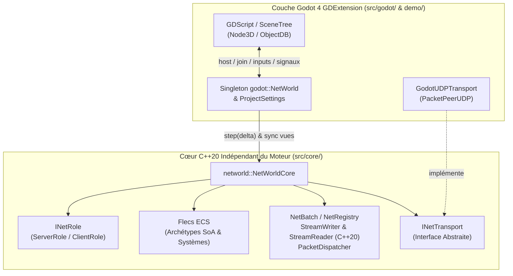

<div align="center">

# Networld

**Bibliothèque de Netcode orientée données en C++20 propulsée par Flecs ECS, avec intégration Godot 4 GDExtension.**

[](#état-actuel--roadmap)
[](#stack-technique)
[](#stack-technique)
[](#stack-technique)
[](./LICENSE)

[🇬🇧 English](./README.md) | **🇫🇷 Français**

</div>

---

> **Projet en cours de développement (WIP)**
> Networld est un projet actif en cours de construction et n'est **pas encore prêt pour la production**. Les APIs, le protocole binaire et l'architecture interne continuent d'évoluer.

---

## Présentation

**Networld** est une bibliothèque expérimentale de **synchronisation réseau orientée données (Data-Oriented Netcode)** écrite en **C++20** et intégrée à **Godot Engine 4** via **GDExtension**.

Le projet repose sur trois objectifs principaux :

1. **Réplication orientée données (SoA)** — Déléguer la simulation et l'état répliqué à **[Flecs ECS](https://github.com/SanderMertens/flecs)** afin de profiter d'une disposition mémoire contiguë (**Structure of Arrays**) et sérialiser des colonnes entières de composants par copie mémoire (`std::memcpy`) plutôt qu'objet par objet (AoS).
2. **Cœur indépendant du moteur (`src/core/`)** — Garder toute la logique réseau 100 % indépendante de Godot (zéro `#include` Godot dans `src/core/`), pour pouvoir tester le cœur hors-moteur ou le porter vers d'autres environnements.
3. **Transport et rôles modulaires** — Abstraire la couche réseau derrière `INetTransport` (actuellement UDP via `PacketPeerUDP` de Godot, avec intégration QUIC prévue) et séparer les topologies derrière `INetRole`.

---

## Architecture

Le projet est strictement découpé en deux couches :



### Structure du dépôt

```text
Networld/
├── src/
│   ├── core/          # Cœur netcode C++20 pur (Flecs, NetBatch SoA, rôles, flux binaires)
│   └── godot/         # Pont Godot 4 GDExtension (Singleton NetWorld, GodotUDPTransport, sync Node3D)
├── demo/              # Projet de démonstration Godot 4
├── thirdparty/flecs/  # Flecs ECS (source C amalgamée)
├── godot-cpp/         # Sous-module godot-cpp
├── devlog/            # Documentation d'architecture & journal de développement par session
└── SConstruct         # Script de compilation SCons (C++20)
```

---

## État actuel & Roadmap

### Déjà implémenté
- [x] Séparation stricte entre le cœur indépendant (`src/core/`) et le pont Godot 4 GDExtension (`src/godot/`)
- [x] Extraction de snapshots en colonnes SoA (`NetBatch` / `NetColumn`) et `NetRegistry` (mapping ID Flecs ↔ ID réseau fixe)
- [x] Sérialisation binaire C++20 (`StreamWriter` / `StreamReader` avec concepts) & `PacketDispatcher`
- [x] Transport multi-clients abstrait (`INetTransport`) + implémentation `GodotUDPTransport` avec keepalive et timeouts
- [x] Séparation des rôles (`INetRole` → `ServerRole` / `ClientRole`) & mode **Listen-Server (Host)** jouable
- [x] Synchronisation serveur autoritaire à **20 Hz**, **interpolation client** de la position et de la rotation (`Quat` / `nlerp`)
- [x] **Prédiction client à pas fixe 60 Hz & réconciliation serveur** (`ack_input_seq` + replay des inputs)
- [x] Singleton Godot `NetWorld` & sélection du transport depuis les `ProjectSettings`

### À venir (Roadmap)
- [ ] Couche d'événements fiables (`ACK` / réémission) pour `SpawnEntity` / `DespawnEntity` et les RPC
- [ ] Découplage complet de la logique gameplay hors de `NetWorldCore` (inputs génériques & step unitaire rejouable)
- [ ] Pont physique optionnel (`INetPhysics` / `PhysicsServer3D` de Godot)
- [ ] Backend de transport **QUIC** optionnel
- [ ] Couche Gameplay Framework optionnelle pour Godot (`NetGameMode`, `NetPlayerController`, `NetPawn`, etc.)

Pour le plan d'architecture détaillé, voir [`devlog/ARCHITECTURE_V0_1.md`](./devlog/ARCHITECTURE_V0_1.md).

---

## Stack technique

- **Langage :** C++20
- **ECS :** [Flecs](https://github.com/SanderMertens/flecs)
- **Moteur :** [Godot 4](https://godotengine.org/) via [godot-cpp](https://github.com/godotengine/godot-cpp) (GDExtension)
- **Build :** [SCons](https://scons.org/)

---

## Compiler et lancer la démo

### Prérequis
- Un compilateur **C++20** (MSVC sous Windows, GCC ou Clang sous Linux/macOS)
- **Python 3** et **SCons** (`pip install scons`)
- **Godot 4** (projet démo configuré pour Godot 4.x / `godot-cpp` 4.5+)

### Étapes de compilation

1. Cloner le dépôt avec ses sous-modules :
   ```bash
   git clone --recursive https://github.com/Leptar/Networld.git
   cd Networld
   ```

2. Compiler l'extension GDExtension (en mode debug) :
   ```bash
   scons target=template_debug
   ```
   *(Pour compiler en release : `scons target=template_release`.)*

3. Ouvrir le dossier `demo/` dans **Godot 4** et lancer la scène principale (`test_networld.tscn`). Il est possible de lancer plusieurs instances via **Déboguer → Personnaliser les instances d'exécution** pour tester un Host + Client en local.

---

## Journal de développement & Documentation

Le dossier [`devlog/`](./devlog/README.md) documente l'ensemble des choix techniques, schémas d'architecture et sessions de développement :

- [`devlog/README.md`](./devlog/README.md) — Index du devlog et historique des sessions
- [`devlog/00_ARCHITECTURE_COMPLETE.md`](./devlog/00_ARCHITECTURE_COMPLETE.md) — Documentation complète de l'architecture initiale et des choix techniques
- [`devlog/ARCHITECTURE_V0_1.md`](./devlog/ARCHITECTURE_V0_1.md) — Plan directeur de l'architecture cible v0.1.0

---

## Bibliothèques tierces

- **[Flecs](https://github.com/SanderMertens/flecs)** — Entity Component System (Licence MIT)
- **[godot-cpp](https://github.com/godotengine/godot-cpp)** — Bindings C++ pour Godot GDExtension (Licence MIT)

---

## Licence

Ce projet est distribué sous licence **MIT** — voir le fichier [LICENSE](./LICENSE) pour plus de détails.
