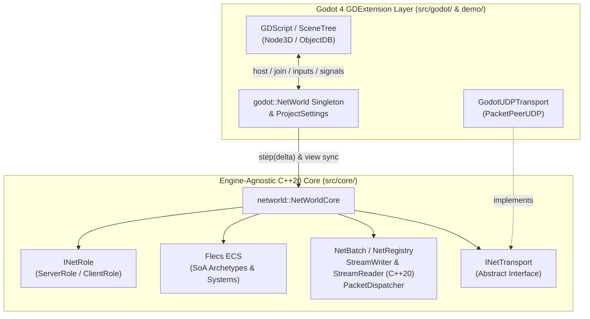

<div align="center">

# Networld

**Data-Oriented Netcode Library in C++20 powered by Flecs ECS, with a Godot 4 GDExtension bridge.**

[](#status--roadmap)
[](#tech-stack)
[](#tech-stack)
[](#tech-stack)
[](./LICENSE)

**🇬🇧 English** | [🇫🇷 Français](./README.fr.md)

</div>

---

> **Work in Progress**
> Networld is under active development and is **not yet production-ready**. APIs, wire formats, and internal architecture are still evolving.
> *Note: Much of the inline documentation and the [development log](./devlog/README.md) are written in French.*

---

## Overview

**Networld** is an experimental, **data-oriented multiplayer networking library** written in **C++20** and integrated into **Godot Engine 4** via **GDExtension**.

Its core design goals are:

1. **Data-Oriented Replication (SoA)** — Delegate simulation and replicated state to **[Flecs ECS](https://github.com/SanderMertens/flecs)** to take advantage of contiguous **Structure of Arrays (SoA)** memory layouts, enabling batch/column binary serialization (`std::memcpy`) instead of object-by-object (AoS) virtual serialization.
2. **Engine-Agnostic Core (`src/core/`)** — Keep the entire networking core 100% free of Godot headers or engine dependencies so it can be tested standalone or ported to other engines.
3. **Pluggable Transport & Roles** — Abstract the network layer behind `INetTransport` (currently UDP via Godot's `PacketPeerUDP`, with custom transports such as QUIC planned) and separate host/client topologies behind `INetRole`.

---

## Architecture

The codebase is strictly split into two layers:



### Repository Structure

```text
Networld/
├── src/
│   ├── core/          # Pure C++20 engine-agnostic netcode core (Flecs, SoA batching, roles, streams)
│   └── godot/         # Godot 4 GDExtension bridge (NetWorld singleton, GodotUDPTransport, Node3D sync)
├── demo/              # Godot 4 demo project showcasing multiplayer sync
├── thirdparty/flecs/  # Flecs ECS (amalgamated C source)
├── godot-cpp/         # godot-cpp submodule
├── devlog/            # Detailed architecture notes & session-by-session devlogs (FR)
└── SConstruct         # SCons build script (C++20)
```

---

## Status & Roadmap

### Implemented
- [x] Strict separation between engine-agnostic core (`src/core/`) and Godot 4 GDExtension adapter (`src/godot/`)
- [x] Data-oriented SoA snapshot extraction (`NetBatch` / `NetColumn`) & `NetRegistry` (Flecs ID ↔ fixed network ID mapping)
- [x] C++20 binary serialization (`StreamWriter` / `StreamReader` with concepts) & `PacketDispatcher`
- [x] Abstract multi-client transport (`INetTransport`) + `GodotUDPTransport` implementation with keepalive & timeouts
- [x] Role separation (`INetRole` → `ServerRole` / `ClientRole`) & playable **Listen-Server (Host)** mode
- [x] Authoritative server sync at **20 Hz**, client-side **position & quaternion (`nlerp`) interpolation**
- [x] Fixed **60 Hz** client-side **prediction & server reconciliation** (`ack_input_seq` + input replay)
- [x] Godot `NetWorld` singleton & `ProjectSettings` transport selection

### Planned (Roadmap)
- [ ] Reliable event channel (`ACK` / resend) for `SpawnEntity` / `DespawnEntity` and RPCs
- [ ] Full decoupling of gameplay logic from `NetWorldCore` (generic input payloads & replayable unit step)
- [ ] Optional physics bridge (`INetPhysics` / Godot `PhysicsServer3D`)
- [ ] Optional **QUIC** transport backend
- [ ] Optional Godot Gameplay Framework layer (`NetGameMode`, `NetPlayerController`, `NetPawn`, etc.)

For the detailed architectural plan, see [`devlog/ARCHITECTURE_V0_1.md`](./devlog/ARCHITECTURE_V0_1.md) *(French)*.

---

## Tech Stack

- **Language:** C++20
- **ECS:** [Flecs](https://github.com/SanderMertens/flecs)
- **Engine Integration:** [Godot 4](https://godotengine.org/) via [godot-cpp](https://github.com/godotengine/godot-cpp) (GDExtension)
- **Build System:** [SCons](https://scons.org/)

---

## Building & Running the Demo

### Prerequisites
- A **C++20** compiler (MSVC on Windows, GCC or Clang on Linux/macOS)
- **Python 3** & **SCons** (`pip install scons`)
- **Godot 4** (demo project configured with Godot 4.x / `godot-cpp` 4.5+)

### Build Steps

1. Clone the repository with submodules:
   ```bash
   git clone --recursive https://github.com/Leptar/Networld.git
   cd Networld
   ```

2. Build the GDExtension library (debug target):
   ```bash
   scons target=template_debug
   ```
   *(For a release build, use `scons target=template_release`.)*

3. Open the `demo/` folder in **Godot 4** and run the project (`test_networld.tscn`). You can launch multiple instances from Godot's **Debug → Customize Run Instances** menu to test Host + Client locally.

---

## Development Log & Documentation

The [`devlog/`](./devlog/README.md) directory documents the full engineering journey, architecture decisions, and session-by-session progress *(written in French)*:

- [`devlog/README.md`](./devlog/README.md) — Devlog index & session history
- [`devlog/00_ARCHITECTURE_COMPLETE.md`](./devlog/00_ARCHITECTURE_COMPLETE.md) — Deep dive into the initial architecture & technical trade-offs
- [`devlog/ARCHITECTURE_V0_1.md`](./devlog/ARCHITECTURE_V0_1.md) — Target v0.1.0 multi-layer architecture blueprint

---

## Third-Party Credits

- **[Flecs](https://github.com/SanderMertens/flecs)** — Entity Component System (MIT License)
- **[godot-cpp](https://github.com/godotengine/godot-cpp)** — C++ bindings for Godot GDExtension (MIT License)

---

## License

This project is licensed under the **MIT License** — see the [LICENSE](./LICENSE) file for details.
