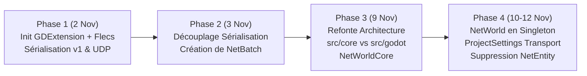
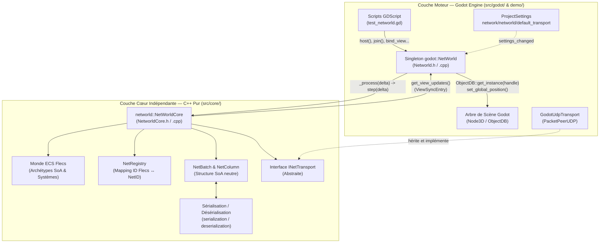
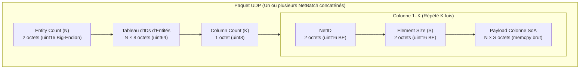

# Documentation Complète & État des Lieux — Projet Networld

> **Date du bilan :** 12 Novembre 2026  
> **Objectif du document :** Poser à plat toute l'architecture construite jusqu'ici, documenter chaque fichier et chaque choix technique en détail, et servir de point de repère avant d'entamer la suite du développement en format Devlog.

---

## Table des matières

1. [Vision et Objectif du Projet](#1-vision-et-objectif-du-projet)
2. [Historique & Évolution du Projet (2 Nov → 12 Nov 2026)](#2-historique--évolution-du-projet-2-nov--12-nov-2026)
3. [Architecture Globale : Séparation `Core` vs `Godot`](#3-architecture-globale--séparation-core-vs-godot)
4. [Les Choix Techniques Majeurs (et Pourquoi)](#4-les-choix-techniques-majeurs-et-pourquoi)
5. [Analyse Détaillée du Code — Couche `src/core/` (C++ Pur & Flecs)](#5-analyse-détaillée-du-code--couche-srccore-c-pur--flecs)
   - [5.1 `NetComponent.h` : Composants POD et découplage des vues](#51-netcomponenth--composants-pod-et-découplage-des-vues)
   - [5.2 `NetRegistry.h` : Traduction bidirectionnelle des IDs de composants](#52-netregistryh--traduction-bidirectionnelle-des-ids-de-composants)
   - [5.3 `NetBatch.h` : Structure intermédiaire SoA (Structure of Arrays)](#53-netbatchh--structure-intermédiaire-soa-structure-of-arrays)
   - [5.4 `serialization.h/.cpp` & `deserialization.h/.cpp` : Protocole binaire](#54-serializationhcpp--deserializationhcpp--protocole-binaire)
   - [5.5 `INetTransport.h` : Abstraction de la couche réseau](#55-inettransporth--abstraction-de-la-couche-réseau)
   - [5.6 `NetworldCore.h/.cpp` : Le cœur ECS et la boucle `step()`](#56-networldcorehcpp--le-cœur-ecs-et-la-boucle-step)
6. [Analyse Détaillée du Code — Couche `src/godot/` (Pont GDExtension)](#6-analyse-détaillée-du-code--couche-srcgodot-pont-gdextension)
   - [6.1 `register_types.h/.cpp` : Point d'entrée GDExtension & Singleton](#61-register_typeshcpp--point-dentrée-gdextension--singleton)
   - [6.2 `GodotUDPTransport.h/.cpp` : Implémentation UDP via `PacketPeerUDP`](#62-godotudptransporthcpp--implémentation-udp-via-packetpeerudp)
   - [6.3 `Networld.h/.cpp` : Singleton Godot, ProjectSettings et synchronisation Node3D](#63-networldhcpp--singleton-godot-projectsettings-et-synchronisation-node3d)
7. [Build System (`SConstruct`) et Démo (`demo/`)](#7-build-system-sconstruct-et-démo-demo)
8. [Où j'en étais à la dernière session (Points d'attention immédiats)](#8-où-jen-étais-à-la-dernière-session-points-dattention-immédiats)

---

## 1. Vision et Objectif du Projet

**Networld** est une bibliothèque de synchronisation réseau orientée données (**Data-Oriented Netcode**), écrite en C++ et intégrée à **Godot Engine 4** via **GDExtension**, propulsée par le moteur ECS (Entity Component System) **Flecs**.

L'idée directrice du projet est de :
1. **Déléguer la simulation et l'état réseau à Flecs (ECS)** pour profiter de la disposition mémoire contiguë (**SoA - Structure of Arrays**).
2. **Sérialiser des colonnes entières de composants par simple copie mémoire (`std::memcpy`)** au lieu de sérialiser objet par objet (AoS).
3. **Garder le cœur de Networld (`src/core/`) 100 % indépendant de Godot**, afin que la bibliothèque puisse être testée hors-moteur ou portée sur d'autres moteurs/environnements, tandis que `src/godot/` ne sert que d'adaptateur (pont visuel + transport réseau Godot + configuration éditeur).

---

## 2. Historique & Évolution du Projet (2 Nov → 12 Nov 2026)

Voici le fil conducteur de ce qui a été accompli depuis le premier commit :

1. **2 Novembre 2026 — Fondations & Prototype initial :**
   - Mise en place de `godot-cpp`, `SConstruct`, et intégration de **Flecs** (`thirdparty/flecs/flecs.c` & `flecs.h`).
   - Création de `NetRegistry` pour associer les IDs dynamiques de Flecs à des IDs réseau fixes (`uint16_t`).
   - Première version de la sérialisation/désérialisation binaire et tests round-trip.
   - Création de l'interface `INetTransport` (avec remplacement de `std::span` par `const uint8_t*` + `size_t` pour rester compatible C++17 sans contrainte C++20) et de son implémentation `GodotUdpTransport`.
   - Première version monolithique de `NetWorld`.
2. **3 Novembre 2026 — Découplage de la sérialisation (`NetBatch`) :**
   - Au départ, `serialize_query` lisait directement `flecs::iter` (code encore visible en commentaire dans `serialization.cpp`).
   - **Refactoring clé :** introduction de `NetBatch` et `NetColumn` pour séparer totalement la sérialisation binaire de Flecs. Désormais, Flecs extrait un `NetBatch` neutre, et le sérialiseur ne manipule plus que des `NetBatch`.
   - Essai d'une classe `NetEntity` (nœud Godot s'enregistrant dans l'ECS).
3. **9 Novembre 2026 — Séparation stricte `src/core/` et `src/godot/` :**
   - Réorganisation des dossiers en `src/core/` (indépendant de Godot) et `src/godot/` (spécifique à Godot).
   - Création de `NetComponent.h` avec sa propre structure `networld::Vec3` pour ne plus dépendre de `godot::Vector3` dans l'ECS.
   - Création de `NetWorldCore` qui encapsule le monde Flecs, le registre, le transport et la boucle `step()`.
   - Remplacement des pointeurs `Node3D*` dans l'ECS par un identifiant abstrait `ExternalView { uint64_t host_handle }` et un tampon de sortie `std::vector<ViewSyncEntry> view_updates_`.
4. **10 au 12 Novembre 2026 — Nettoyage, Singleton et Usine de Transports :**
   - Suppression des anciens fichiers de test temporaires (`flecs_test.h`, `components.h`, `test_roundtrip_serialize.cpp`).
   - Transformation de `NetWorld` en **Singleton Godot** enregistré auprès de `Engine` au démarrage (`Networld`).
   - Ajout d'un système d'enregistrement de transports (`register_transport` / `TransportFactory`) couplé aux **ProjectSettings** de Godot (`network/networld/default_transport`), permettant de choisir le transport réseau dans un menu déroulant directement dans l'éditeur Godot !
   - Suppression de `NetEntity` (le 12 nov) car inutilisé dans la nouvelle architecture pilotée par `NetWorldCore` et `ExternalView`.

---

## 3. Architecture Globale : Séparation `Core` vs `Godot`

Le projet est divisé en deux couches hermétiques :
- **La couche `src/core/`** ne contient **aucun `#include` de Godot**. Elle ne connaît que la STL C++ et Flecs.
- **La couche `src/godot/`** inclut `godot-cpp` et `src/core/`, fait office de façade pour GDScript et l'éditeur Godot, fournit l'implémentation UDP Godot (`GodotUdpTransport`) et applique les positions calculées par le Core sur les `Node3D` de la scène.

---

## 4. Les Choix Techniques Majeurs (et Pourquoi)

### Choix n°1 : Flecs ECS et Sérialisation par Colonnes (SoA)
- **Problème classique :** Dans une architecture orientée objet classique (AoS - *Array of Structures*), chaque entité réseau est un objet dispersé en mémoire. Pour envoyer un snapshot réseau, il faut parcourir chaque objet, appeler une méthode `serialize()` virtuelle et copier ses champs un par un.
- **Solution choisie :** Dans **Flecs**, les entités ayant les mêmes composants (même *Archétype* / *Table*, ex: `[Position3D, Velocity3D, Networked]`) stockent leurs composants dans des tableaux contigus en mémoire : un tableau de tous les `Position3D`, un tableau de tous les `Velocity3D`, et un tableau d'IDs d'entités `uint64_t`.
- **Gain :** Lors de l'extraction (`extract_batch`), Networld récupère directement le pointeur brut de la colonne via `ecs_field_w_size` et copie **toutes les positions de toutes les entités de l'archétype en un seul `std::memcpy`** !

### Choix n°2 : `NetBatch` comme structure tampon entre Flecs et le Réseau
- **Pourquoi ne pas sérialiser directement dans `flecs::iter` ?**
  Dans la toute première version (conservée en commentaire en bas de [serialization.cpp](file:///c:/Users/leoul/Godot/Projects/Networld/src/core/serialization.cpp#L44-L106)), la fonction `serialize_query` prenait directement un `flecs::iter&`. Cela couplait le format de paquet binaire à l'API interne de Flecs et rendait la désérialisation asymétrique.
- **Avec `NetBatch` ([NetBatch.h](file:///c:/Users/leoul/Godot/Projects/Networld/src/core/NetBatch.h)) :**
  - `serialize_batch(const NetBatch&)` et `deserialize_buffer(const uint8_t*, size_t)` sont des fonctions **pures**, sans aucune dépendance à Flecs ni à Godot.
  - On peut les tester unitairement en créant un `NetBatch` à la main et en vérifiant que `deserialize_buffer(serialize_batch(b)) == b`.

### Choix n°3 : `NetRegistry` pour stabiliser les identifiants de composants sur le réseau
- **Problème :** Dans Flecs, chaque composant reçoit un `flecs::id_t` (64 bits) généré dynamiquement à l'exécution selon l'ordre d'enregistrement des composants. Rien ne garantit à 100 % qu'un client et un serveur (ou deux builds différents) auront le même ID interne Flecs, et envoyer 8 octets par type de composant gaspille de la bande passante.
- **Solution ([NetRegistry.h](file:///c:/Users/leoul/Godot/Projects/Networld/src/core/NetRegistry.h)) :** Deux `std::unordered_map` font la traduction bidirectionnelle entre le `flecs::id_t` (64 bits local) et un `uint16_t net_id` (16 bits fixe sur le réseau, ex: `10` = `Position3D`, `11` = `Velocity3D`, `12` = `Networked`). De plus, tout composant dont le `net_id` vaut `0` (comme `ExternalView` ou `Gravity`) est automatiquement ignoré par la sérialisation réseau !

### Choix n°4 : Découplage Moteur via `ExternalView` (`host_handle`) et `ViewSyncEntry`
- **Problème :** Si un composant Flecs stockait un `godot::Node3D*`, alors :
  1. `NetWorldCore` dépendrait de `godot-cpp`.
  2. Si un `Node3D` était détruit dans Godot (`queue_free()`), le pointeur dans l'ECS deviendrait un *dangling pointer* provoquant un crash immédiat.
- **Solution ([NetComponent.h](file:///c:/Users/leoul/Godot/Projects/Networld/src/core/NetComponent.h#L37-L46)) :**
  - L'entité Flecs stocke un composant `ExternalView { uint64_t host_handle }`, où `host_handle` est l'`ObjectID` (`visual_node->get_instance_id()`) de Godot.
  - À la fin de chaque tick ECS, le système `CollectViewUpdates` remplit un vecteur `view_updates_` contenant des triplets `{ entity_id, host_handle, position }`.
  - Dans `NetWorld::_process`, la couche Godot parcourt `core_.get_view_updates()`, interroge `ObjectDB::get_instance(update.host_handle)` (ce qui est **100 % sécurisé** en Godot : renvoie `nullptr` si le nœud a été détruit) et met à jour la `global_position` du `Node3D`.

### Choix n°5 : Injection de dépendance pour le Transport (`INetTransport` + `TransportFactory`)
- **Pourquoi :** Un jeu peut commencer son développement en UDP brut (`PacketPeerUDP`), puis vouloir passer sur **ENet**, **SteamNetworkingSockets** (Steamworks) ou **WebRTC** sans toucher une seule ligne de `NetWorldCore`.
- **Implémentation :** `NetWorldCore` possède un `std::unique_ptr<INetTransport>`. Côté Godot, `NetWorld` maintient un registre statique de constructeurs (`TransportFactory`) et expose automatiquement la liste des transports enregistrés sous forme d'énumération (`PROPERTY_HINT_ENUM`) dans `Project Settings > Network > Networld > Default Transport`.

---

## 5. Analyse Détaillée du Code — Couche `src/core/` (C++ Pur & Flecs)

### 5.1 `NetComponent.h` : Composants POD et découplage des vues
Fichier : [NetComponent.h](file:///c:/Users/leoul/Godot/Projects/Networld/src/core/NetComponent.h)

Tous les éléments du cœur sont dans le namespace `networld`.
- **`struct Vec3`** (lignes 14-26) : Vecteur 3D minimaliste (`float x, y, z`) avec surcharge des opérateurs `+`, `*` (scalaire) et `+=`. Garantit une taille exacte de `12 octets` (`3 * sizeof(float)`), Trivial / POD, copiable par `std::memcpy`.
- **Composants de simulation (POD)** (lignes 29-31) :
  - `Position3D { Vec3 value; }` (12 octets) — Enregistré avec `NetID = 10`.
  - `Velocity3D { Vec3 value; }` (12 octets) — Enregistré avec `NetID = 11`.
  - `Gravity { Vec3 force; }` (12 octets) — Composant purement local pour l'instant (pas de `NetID`).
- **Tag Réseau** (ligne 34) :
  - `struct Networked {};` — Tag Flecs (taille 0 octet) permettant de filtrer uniquement les entités qui doivent être répliquées sur le réseau via `.with<Networked>()`.
- **Pont avec le moteur hôte** (lignes 37-46) :
  - `struct ExternalView { uint64_t host_handle = 0; };` — Composant attaché aux entités qui ont une représentation visuelle dans le moteur hôte.
  - `struct ViewSyncEntry { uint64_t entity_id; uint64_t host_handle; Vec3 position; };` — Structure de sortie produite à chaque frame par le système `CollectViewUpdates`.

---

### 5.2 `NetRegistry.h` : Traduction bidirectionnelle des IDs de composants
Fichier : [NetRegistry.h](file:///c:/Users/leoul/Godot/Projects/Networld/src/core/NetRegistry.h)

Classe de correspondance (`local_to_net_` et `net_to_local_`) :
- `register_component(flecs::id_t local_id, uint16_t net_id)` : Lie l'ID Flecs local à un identifiant réseau sur 2 octets.
- `get_net_id(flecs::id_t local_id)` : Renvoie le `net_id` (ou `0` si le composant n'est pas synchronisé sur le réseau). Utilisé pendant l'**Egress** (`extract_batch`).
- `get_local_id(uint16_t net_id)` : Renvoie le `flecs::id_t` local correspondant au `net_id` reçu d'un paquet. Utilisé pendant l'**Ingress** (`apply_batches`).

---

### 5.3 `NetBatch.h` : Structure intermédiaire SoA (Structure of Arrays)
Fichier : [NetBatch.h](file:///c:/Users/leoul/Godot/Projects/Networld/src/core/NetBatch.h)

Représente les données d'un archétype (table Flecs) prêtes à être sérialisées ou fraîchement désérialisées :
- **`struct NetColumn`** :
  - `uint16_t net_id` : L'identifiant réseau du composant (ex: `10` pour `Position3D`).
  - `uint16_t element_size` : La taille en octets d'un seul composant (ex: `12` pour `Position3D`).
  - `std::vector<uint8_t> payload` : Les octets bruts contigus de ce composant pour toutes les entités du lot (`taille = entities.size() * element_size`).
- **`struct NetBatch`** :
  - `std::vector<uint64_t> entities` : Liste des IDs des entités de ce bloc.
  - `std::vector<NetColumn> columns` : Liste des colonnes de composants associées à ces entités.

---

### 5.4 `serialization.h/.cpp` & `deserialization.h/.cpp` : Protocole binaire
Fichiers : [serialization.h](file:///c:/Users/leoul/Godot/Projects/Networld/src/core/serialization.h), [serialization.cpp](file:///c:/Users/leoul/Godot/Projects/Networld/src/core/serialization.cpp), [deserialization.h](file:///c:/Users/leoul/Godot/Projects/Networld/src/core/deserialization.h), [deserialization.cpp](file:///c:/Users/leoul/Godot/Projects/Networld/src/core/deserialization.cpp)

#### Schéma du Format Binaire d'un `NetBatch` sur le réseau
Un paquet UDP peut contenir **un ou plusieurs `NetBatch` concaténés** (un par archétype Flecs correspondant à la requête). Voici la structure exacte au niveau de l'octet :

#### Fonctionnement de `serialize_batch(const NetBatch& batch)` ([serialization.cpp](file:///c:/Users/leoul/Godot/Projects/Networld/src/core/serialization.cpp#L8-L42)) :
1. Vérifie si `batch.entities` est vide (si oui, retourne un buffer vide).
2. Écrit `entity_count` (`uint16_t`) en **Big-Endian** (`(entity_count >> 8) & 0xFF`, puis `entity_count & 0xFF`).
3. Redimensionne le buffer et copie d'un bloc les `N` identifiants d'entités (`N * sizeof(uint64_t)`) via `std::memcpy`.
4. Écrit `column_count` (`uint8_t`).
5. Pour chaque `NetColumn` :
   - Écrit `col.net_id` sur 2 octets Big-Endian.
   - Écrit `col.element_size` sur 2 octets Big-Endian.
   - Copie tout `col.payload` en un seul `std::memcpy`.

#### Fonctionnement de `deserialize_buffer(const uint8_t* data, size_t size)` ([deserialization.cpp](file:///c:/Users/leoul/Godot/Projects/Networld/src/core/deserialization.cpp#L7-L52)) :
1. Lit le buffer en boucle (`while (offset + 3 <= size)`) pour décoder tous les blocs `NetBatch` présents dans le paquet UDP.
2. À chaque étape, effectue des **vérifications de dépassement de tampon (bounds checking)** :
   - `if (offset + entities_bytes + 1 > size) break;`
   - `if (offset + 4 > size) break;`
   - `if (offset + payload_bytes > size) break;`
   Cela protège le client ou le serveur contre les paquets UDP corrompus ou tronqués.
3. Reconstruit chaque `NetBatch` et ses `NetColumn` par `std::memcpy` et retourne `std::vector<NetBatch>`.

---

### 5.5 `INetTransport.h` : Abstraction de la couche réseau
Fichier : [INetTransport.h](file:///c:/Users/leoul/Godot/Projects/Networld/src/core/INetTransport.h)

Définit le contrat minimal que n'importe quelle bibliothèque réseau doit respecter :
- `enum class NetChannel : uint8_t` :
  - `UNRELIABLE_STATE = 0` : Pour les snapshots d'état continus (positions, vélocités).
  - `RELIABLE_EVENTS = 1` : Prévu pour les événements critiques (spawn, destruction, RPC).
- `struct NetPacket` : Contient `sender_peer_id` (`uint32_t`), `channel` (`NetChannel`), et `payload` (`std::vector<uint8_t>`).
- Interface `INetTransport` :
  - `open_as_host(uint16_t port)` / `open_as_client(const std::string& host_ip, uint16_t port)` / `close()`
  - `poll()` : Lit les sockets système et remplit la file de réception interne.
  - `send(uint32_t target_peer_id, NetChannel channel, const uint8_t* data, size_t size)` : Envoie un buffer brut.
  - `recv(NetPacket& out_packet)` : Dépile un paquet reçu (retourne `false` s'il n'y a plus rien à lire).

---

### 5.6 `NetworldCore.h/.cpp` : Le cœur ECS et la boucle `step()`
Fichiers : [NetworldCore.h](file:///c:/Users/leoul/Godot/Projects/Networld/src/core/NetworldCore.h), [NetworldCore.cpp](file:///c:/Users/leoul/Godot/Projects/Networld/src/core/NetworldCore.cpp)

C'est le chef d'orchestre de la bibliothèque.

#### Initialisation dans le constructeur `NetWorldCore::NetWorldCore()` ([NetworldCore.cpp](file:///c:/Users/leoul/Godot/Projects/Networld/src/core/NetworldCore.cpp#L66-L101)) :
1. **Enregistrement réseau des composants :**
   - `Position3D` $\rightarrow$ NetID `10`
   - `Velocity3D` $\rightarrow$ NetID `11`
   - `Networked` $\rightarrow$ NetID `12`
2. **Réflexion Flecs & Flecs Explorer :**
   - Enregistre les membres `x, y, z` de `Vec3` ainsi que les membres de `Position3D`, `Velocity3D`, `Gravity` auprès du système de réflexion de Flecs.
   - Active `ecs_.set<flecs::Rest>({});` : cela active le serveur REST intégré de Flecs, permettant d'inspecter le monde ECS en temps réel dans l'application web **Flecs Explorer** !
3. **Déclaration des 3 Systèmes Flecs** (exécutés dans l'ordre lors de `ecs_.progress(delta_time)`) :
   - `ApplyGravity` (`<Velocity3D, const Gravity>`) : `v.value += g.force * it.delta_time();`
   - `ApplyMovement` (`<Position3D, const Velocity3D>`) : `p.value += v.value * it.delta_time();`
   - `CollectViewUpdates` (`<const Position3D, const ExternalView>`) : Si `v.host_handle != 0`, pousse `{e.id(), v.host_handle, p.value}` dans `view_updates_`.

#### Connexion Initiale (`start_host` et `start_client`) ([NetworldCore.cpp](file:///c:/Users/leoul/Godot/Projects/Networld/src/core/NetworldCore.cpp#L111-L137)) :
- **Sur le Host (`start_host`) :** Ouvre le transport en mode Host, et crée l'entité de test `"ServerPlayer"` à la position `(0, 5, 0)` avec une vélocité `(1, 0, 0)` et le tag `Networked`. (Note : comme `"ServerPlayer"` est la toute première entité créée après les composants aussi bien sur le Host que sur le Client, elle obtient le même ID d'entité Flecs des deux côtés).
- **Sur le Client (`start_client`) :** Ouvre le transport vers `host_ip:port`, crée l'entité `"ServerPlayer"` à `(0, 0, 0)` et envoie un **Knock Packet** (`0xFF`, 1 octet) au Host.
  - *Pourquoi ce Knock Packet ?* Comme UDP est sans connexion (*connectionless*), le Host ne connaît pas l'IP et le port éphémère du Client tant que le Client ne lui a pas envoyé au moins un datagramme ! Ce paquet de 1 octet (trop court pour être un `NetBatch` valide, donc ignoré sans erreur par `deserialize_buffer` qui exige `size >= 3`) permet à `GodotUdpTransport::poll()` côté Host de capturer l'IP et le port du Client pour lui envoyer les snapshots suivants.

#### La boucle `NetWorldCore::step(float delta_time)` ([NetworldCore.cpp](file:///c:/Users/leoul/Godot/Projects/Networld/src/core/NetworldCore.cpp#L143-L176)) :
C'est le pipeline fondamental exécuté à chaque frame :

```mermaid
sequenceDiagram
    participant Godot as Godot (_process)
    participant Core as NetWorldCore
    participant Trans as INetTransport
    participant Ser as Serializer / Deserializer
    participant ECS as Flecs World

    Godot->>Core: step(delta_time)
    
    rect rgb(40, 60, 90)
    Note over Core,ECS: 1. INGRESS RÉSEAU
    Core->>Trans: poll()
    loop Tant que recv(pkt) == true
        Trans-->>Core: NetPacket (payload)
        Core->>Ser: deserialize_buffer(payload)
        Ser-->>Core: std::vector<NetBatch>
        Core->>ECS: apply_batches() via ecs_set_id()
    end
    end

    rect rgb(40, 80, 50)
    Note over Core,ECS: 2. SIMULATION ECS & COLLECTE DES VUES
    Core->>Core: view_updates_.clear()
    Core->>ECS: ecs_.progress(delta_time)
    Note right of ECS: 1. ApplyGravity<br/>2. ApplyMovement<br/>3. CollectViewUpdates -> remplit view_updates_
    end

    rect rgb(80, 50, 50)
    Note over Core,ECS: 3. EGRESS RÉSEAU (Si is_server_ == true)
    Core->>ECS: query<Position3D, Velocity3D>().with<Networked>()
    loop Pour chaque table (archétype) de la query
        ECS-->>Core: flecs::iter (table SoA)
        Core->>Core: extract_batch(it) (memcpy des colonnes)
        Core->>Ser: serialize_batch(batch)
        Ser-->>Core: bloc binaire
    end
    Core->>Trans: send(out_buffer)
    end

    Godot->>Core: get_view_updates()
    Core-->>Godot: std::vector<ViewSyncEntry>
    Note over Godot: Met à jour Node3D->set_global_position()
```

#### Détail d'`extract_batch` et `apply_batches` ([NetworldCore.cpp](file:///c:/Users/leoul/Godot/Projects/Networld/src/core/NetworldCore.cpp#L13-L64)) :
- **`extract_batch(const flecs::iter& it)`** :
  - Accède à l'itérateur C bas niveau `const flecs::iter_t* c_it = it.c_ptr();`.
  - Copie tous les IDs d'entités de la table (`c_it->entities`) dans `batch.entities`.
  - Parcourt chaque champ de la requête (`c_it->field_count`) : récupère le `comp_id`, demande son `net_id` au `registry_`, récupère sa taille via `ecs_field_size(c_it, i)` et le pointeur du tableau contigu via `ecs_field_w_size(c_it, comp_size, i)`.
  - Si `net_id != 0` et `comp_size != 0`, copie toute la colonne en mémoire vers `col.payload`.
- **`apply_batches(const std::vector<NetBatch>& batches)`** :
  - Pour chaque `NetBatch` et chaque `NetColumn`, retrouve le `local_id` Flecs via `registry_.get_local_id(col.net_id)`.
  - Pour chaque entité `i`, vérifie `ecs_.is_alive(entity_id)`, calcule l'adresse de l'élément `col.payload.data() + (i * col.element_size)` et injecte la donnée brute directement dans Flecs avec l'API C `ecs_set_id(ecs_.c_ptr(), entity_id, local_id, col.element_size, elem_ptr)`.

---

## 6. Analyse Détaillée du Code — Couche `src/godot/` (Pont GDExtension)

### 6.1 `register_types.h/.cpp` : Point d'entrée GDExtension & Singleton
Fichiers : [register_types.h](file:///c:/Users/leoul/Godot/Projects/Networld/src/godot/register_types.h), [register_types.cpp](file:///c:/Users/leoul/Godot/Projects/Networld/src/godot/register_types.cpp)

- Expose la fonction C `Networld(...)` (correspondant à `entry_symbol = "Networld"` dans `gdexample.gdextension`).
- Au niveau `MODULE_INITIALIZATION_LEVEL_SCENE` :
  1. Enregistre la classe `NetWorld` dans `ClassDB`.
  2. Instancie le singleton `networld_instance = memnew(NetWorld)` et l'enregistre auprès du moteur via `Engine::get_singleton()->register_singleton("Networld", NetWorld::get_networld())`.
  3. Enregistre le transport par défaut `"Godot UDP"` via `NetWorld::register_transport`.
- À la fermeture (`uninitialize_networld_module`), désenregistre le singleton et libère proprement la mémoire (`memdelete(networld_instance)`).

---

### 6.2 `GodotUDPTransport.h/.cpp` : Implémentation UDP via `PacketPeerUDP`
Fichiers : [GodotUDPTransport.h](file:///c:/Users/leoul/Godot/Projects/Networld/src/godot/GodotUDPTransport.h), [GodotUDPTransport.cpp](file:///c:/Users/leoul/Godot/Projects/Networld/src/godot/GodotUDPTransport.cpp)

Implémente `INetTransport` en encapsulant un `godot::Ref<PacketPeerUDP>` :
- **`open_as_host(port)`** : Appelle `udp->bind(port)` et passe `is_host = true`.
- **`open_as_client(host_ip, port)`** : Appelle `udp->bind(0)` (port aléatoire attribué par l'OS) et verrouille la destination avec `udp->set_dest_address(target_ip, target_port)`.
- **`poll()`** :
  - Tant que `udp->get_available_packet_count() > 0`, lit le `PackedByteArray`.
  - Si on est `is_host`, mémorise l'IP et le port de l'émetteur (`get_packet_ip()`, `get_packet_port()`) et appelle `udp->set_dest_address(target_ip, target_port)` pour pouvoir lui répondre (architecture prototype 1v1).
  - Pousse le paquet dans la file `std::queue<NetPacket> rx_queue`.
- **`send(...)`** : Copie les octets bruts dans un `PackedByteArray` et l'envoie via `udp->put_packet(godot_array)`.
- **`recv(...)`** : Dépile le prochain `NetPacket` de `rx_queue`.

---

### 6.3 `Networld.h/.cpp` : Singleton Godot, ProjectSettings et synchronisation Node3D
Fichiers : [Networld.h](file:///c:/Users/leoul/Godot/Projects/Networld/src/godot/Networld.h), [Networld.cpp](file:///c:/Users/leoul/Godot/Projects/Networld/src/godot/Networld.cpp)

Hérite de `godot::Node` (`GDCLASS(NetWorld, Node)`).
- **Intégration aux ProjectSettings (Constructeur & `_on_settings_changed`)** :
  - Crée le paramètre `network/networld/default_transport` dans `ProjectSettings` avec la valeur initiale `"Godot UDP"`.
  - Construit dynamiquement la `hint_string` à partir de `transport_registry_` et ajoute une propriété avec `PROPERTY_HINT_ENUM` pour afficher une liste déroulante dans l'éditeur Godot.
  - Se connecte au signal `"settings_changed"` de `ProjectSettings` pour recréer et injecter à chaud le transport choisi dans `core_.set_transport(create_transport())`.
- **Méthodes exposées à GDScript (`_bind_methods`)** :
  - `host(int port)` : Démarre le Core en tant que serveur.
  - `join(String ip, int port)` : Démarre le Core en tant que client.
  - `bind_view_to_server_player(Node3D* visual_node)` : Récupère `visual_node->get_instance_id()` et appelle `core_.bind_external_view("ServerPlayer", handle)`.
- **Boucle `_process(double delta)`** :
  - Appelle `core_.step(static_cast<float>(delta))`.
  - Parcourt `core_.get_view_updates()`, retrouve chaque `Node3D*` via `ObjectDB::get_instance(update.host_handle)` et applique `node->set_global_position(...)`.

---

## 7. Build System (`SConstruct`) et Démo (`demo/`)

### `SConstruct` ([SConstruct](file:///c:/Users/leoul/Godot/Projects/Networld/SConstruct))
- S'appuie sur l'environnement SCons de `godot-cpp/SConstruct`.
- Utilise `VariantDir` pour compiler proprement les fichiers `.obj` dans `build/src` et `build/thirdparty` sans polluer les dossiers sources.
- Compile tous les `.cpp` de `src/`, `src/core/`, `src/godot/` ainsi que `thirdparty/flecs/flecs.c`.
- Ajoute la bibliothèque système `ws2_32` (Winsock2) sur Windows, requise par Flecs (notamment pour l'API REST / sockets).
- Produit la DLL dans `demo/bin/Networld.windows.template_debug.x86_64.dll` (et release).

### Scène de démo ([demo/test_networld.gd](file:///c:/Users/leoul/Godot/Projects/Networld/demo/test_networld.gd) & [demo/test_networld.tscn](file:///c:/Users/leoul/Godot/Projects/Networld/demo/test_networld.tscn))
- Crée par code un cube (`MeshInstance3D` + `BoxMesh`), une `Camera3D` et deux boutons UI (`Démarrer en tant que HOST` et `Démarrer en tant que CLIENT`).
- Au clic sur Host ou Client :
  1. Ajoute le singleton `Networld` comme enfant de la scène (`add_child(Networld)`) afin que sa méthode `_process(delta)` soit appelée à chaque frame par l'arbre de scène Godot.
  2. Appelle `Networld.host(7070)` ou `Networld.join("127.0.0.1", 7070)`.
  3. Lie le cube visuel à l'entité `"ServerPlayer"` via `Networld.bind_view_to_server_player(mesh_instance)`.
  4. Le Host fait avancer le cube sur l'axe X via le système Flecs `ApplyMovement` (`Velocity3D(1,0,0)`), sérialise les colonnes en SoA et les envoie en UDP au Client, dont le cube se déplace en parfaite synchronisation.

---

## 8. Où j'en étais à la dernière session (Points d'attention immédiats)

En inspectant l'état exact du dépôt au dernier commit (`876342fb` - *"REMOVE NetEntity"*), voici les **4 petits détails techniques en suspens** qu'il faudra avoir en tête dès la reprise du code :

> [!WARNING]
> **1. Reliquat de `NetEntity` dans `register_types.cpp`**  
> Les fichiers `NetEntity.h` et `NetEntity.cpp` ont été supprimés lors du dernier commit, mais [register_types.cpp](file:///c:/Users/leoul/Godot/Projects/Networld/src/godot/register_types.cpp#L8) contient encore `#include "NetEntity.h"` (ligne 8) et `ClassDB::register_class<NetEntity>();` (ligne 29). Il faudra supprimer ces deux lignes pour que la prochaine compilation SCons réussisse.

> [!IMPORTANT]
> **2. Ordre d'enregistrement du transport dans `register_types.cpp`**  
> Dans [register_types.cpp](file:///c:/Users/leoul/Godot/Projects/Networld/src/godot/register_types.cpp#L22-L27), `networld_instance = memnew(NetWorld);` (ligne 22) est appelé **avant** `NetWorld::register_transport("Godot UDP", ...)` (ligne 25).  
> Or, le constructeur `NetWorld::NetWorld()` parcourt `transport_registry_` pour générer le menu déroulant des `ProjectSettings` et appelle `create_transport()`. Comme `"Godot UDP"` est enregistré juste après le `memnew`, `transport_registry_` est vide au moment où le constructeur s'exécute (ce qui déclenche le message d'erreur de fallback `"Transport introuvable"`).  
> **Correction simple :** Appeler `NetWorld::register_transport("Godot UDP", ...)` **avant** `networld_instance = memnew(NetWorld);`.

> [!NOTE]
> **3. `host()` et `join()` dans `Networld.cpp` écrasent le transport avec `GodotUdpTransport` en dur**  
> Dans [Networld.cpp](file:///c:/Users/leoul/Godot/Projects/Networld/src/godot/Networld.cpp#L117-L125), `host()` et `join()` font encore `core_.set_transport(std::make_unique<GodotUdpTransport>());` au lieu d'utiliser `create_transport()` (ou le transport déjà configuré par les `ProjectSettings`).

> [!TIP]
> **4. Prochaines grandes étapes logiques d'architecture**  
> - Supprimer l'entité codée en dur `"ServerPlayer"` dans `start_host`/`start_client` pour passer à un vrai système de spawn dynamique d'entités (`spawn_local_entity` est déjà préparé dans `Networld.cpp` !).
> - Gérer le multi-clients dans `GodotUdpTransport` (remplacer le couple unique `target_ip`/`target_port` par une table `peer_id -> (ip, port)`).
> - Gérer la correspondance d'IDs d'entités (`NetworkID` d'entité vs `flecs::entity_t` local) lorsque des entités sont créées dynamiquement dans un ordre différent entre le serveur et les clients.
