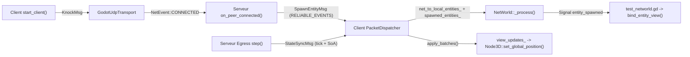

# Devlog #03 — Messages Réseau (`NetMessage`), Routage `NetWorldCore` & Sync Visuelle Dynamique

| Métadonnées | Détails |
| :--- | :--- |
| **Date** | `2026-11-16` |
| **Heure (Début → Fin)** | `19:28` → `23:35` |
| **Temps passé** | `4h 07m` |
| **Branche / Commit** | `network-logic` (`fa09e14`) |
| **Statut de fin de session** | 🟡 En cours (WIP) |

---

## 1. Contexte & Objectifs de la session
> *Où j'en étais en ouvrant le projet aujourd'hui, et qu'est-ce que je voulais accomplir pendant cette session ?*

En reprenant après la session #02 (`40a3f83`), la compilation SCons incluant `PacketDispatcher` a été vérifiée proprement juste avant de commencer. Les briques `NetStream.h`, `StreamWriter`, `StreamReader` et `PacketDispatcher` étaient prêtes, mais `NetWorldCore::step()` appelait encore `deserialize_buffer()` directement sur tout `NetPacket` reçu, sans tenir compte de `pkt.event`, et le client créait toujours une entité `"ServerPlayer"` en dur liée à un seul cube dans `demo/test_networld.gd`.

L'objectif de la session était de définir les vrais messages réseau, de brancher `PacketDispatcher` et `NetEvent` dans `NetWorldCore`, puis de relier dynamiquement le spawn/despawn et le suivi des positions jusqu'à Godot.

- [x] Définir `PacketId` et les structs `NetMessage` (`KnockMsg`, `SpawnEntityMsg`, `DespawnEntityMsg`, `StateSyncMsg`) dans `NetMessage.h` (`6f298a4`)
- [x] Remplacer le knock brut (`0xFF`) et la boucle réseau brute dans `NetWorldCore` par `encode_packet`, `PacketDispatcher` et un `switch (pkt.event)` (`8d0616d`)
- [x] Implémenter `on_peer_connected` / `on_peer_disconnected`, le mapping d'IDs Flecs (`peer_entities_`, `net_to_local_entities_`) et les signaux Godot `entity_spawned` / `entity_despawned` + `bind_entity_view` (`fa09e14`)
- [ ] Stabiliser le despawn côté clients (keepalive UDP contre `PEER_TIMEOUT`)

---

## 2. Ce qui a été fait (Résumé des changements)
> *Liste claire des fonctionnalités ajoutées, modifiées ou supprimées.*

### Fichiers touchés
- `src/core/NetMessage.h` *(nouveau, `6f298a4`)* : définition de `enum class PacketId : std::uint8_t` (`KNOCK = 1`, `SPAWN_ENTITY = 2`, `DESPAWN_ENTITY = 3`, `STATE_SYNC = 4`) et des structs `KnockMsg`, `SpawnEntityMsg`, `DespawnEntityMsg`, `StateSyncMsg`, toutes vérifiées à la compilation par `static_assert(NetMessage<...>)`.
- `src/core/NetComponent.h` (`fa09e14`) : ajout de `EntitySpawnEntry` (`entity_id`, `position`) pour transporter les événements de spawn depuis `NetWorldCore`.
- `src/core/NetworldCore.h` & `src/core/NetworldCore.cpp` (`6f298a4`, `8d0616d`, `fa09e14`) :
  - Ajout de `packet_dispatcher_`, `last_received_tick_`, `peer_entities_` (`peer_id -> server_entity_id`), `net_to_local_entities_` (`server_entity_id -> local_entity_id`), `spawned_entities_` et `despawned_entities_`.
  - Enregistrement des handlers par rôle dans `start_host()` (`KnockMsg`) et `start_client()` (`StateSyncMsg`, `SpawnEntityMsg`, `DespawnEntityMsg`), et remplacement du knock `0xFF` par `encode_packet(KnockMsg{})` sur `NetChannel::RELIABLE_EVENTS`.
  - Remplacement de `bind_external_view(const char* name, ...)` par `bind_entity_view(uint64_t entity_id, uint64_t host_handle)`.
  - Routage de `NetEvent::CONNECTED`, `NetEvent::DISCONNECTED` et `NetEvent::DATA` dans `step()`, incrément de `current_tick_`, et envoi de `StateSyncMsg` en `PEER_BROADCAST` côté serveur.
  - Implémentation de `on_peer_connected()` / `on_peer_disconnected()` et traduction `net_to_local_entities_` dans `apply_batches()`.
- `src/godot/Networld.h` & `src/godot/Networld.cpp` (`fa09e14`) :
  - Remplacement de `bind_view_to_server_player()` par `bind_entity_view(uint64_t id, Node3D* visual_node)` exposé dans `_bind_methods()`.
  - Déclaration des signaux `entity_spawned(entity_id, position)` et `entity_despawned(entity_id)`.
  - Émission des signaux dans `_process()`, mise à jour des `Node3D` via `get_view_updates()`, puis `.clear()` de `spawned_entities_` / `despawned_entities_` en fin de `_process()` (et dans `host()`/`join()`).
- `demo/test_networld.gd` (`fa09e14`) : remplacement du cube unique par un dictionnaire `views` (`entity_id -> MeshInstance3D`) connecté à `entity_spawned` et `entity_despawned`, avec appel à `Networld.bind_entity_view()` et `queue_free()`.

### Explication du fonctionnement
- **Handshake & Spawn initial :** Au démarrage, le client envoie `encode_packet(KnockMsg{})` vers `PEER_SERVER`. Ce premier datagramme UDP permet à `GodotUdpTransport::poll()` d'attribuer un `peer_id` au client et de générer un `NetPacket` avec `NetEvent::CONNECTED`.
- **Côté Serveur (`on_peer_connected` / `on_peer_disconnected`) :** À la connexion d'un pair, le serveur crée une entité joueur (`create_networked_entity(Vec3{0,5,0})`), l'enregistre dans `peer_entities_[peer_id]` et dans `spawned_entities_` (pour son propre affichage). Il envoie au nouveau client un `SpawnEntityMsg` pour chaque entité `<Networked>` déjà présente (incluant `ServerPlayer` et la sienne), puis notifie les autres clients connectés du nouveau joueur. À la déconnexion, il détruit l'entité, l'ajoute à `despawned_entities_` et diffuse `DespawnEntityMsg` en `PEER_BROADCAST`.
- **Côté Client (`PacketDispatcher` + `apply_batches`) :**
  - `SpawnEntityMsg` crée une entité Flecs locale (idempotent via `net_to_local_entities_.contains()`), stocke la correspondance `server_id -> local_id` et pousse `{local_id, msg.position}` dans `spawned_entities_`.
  - `StateSyncMsg` ignore tout paquet obsolète (`msg.tick <= last_received_tick_`) puis applique les `NetBatch` en traduisant chaque `batch.entities[i]` via `net_to_local_entities_`.
  - `DespawnEntityMsg` pousse l'ID local (`it->second`) dans `despawned_entities_`, détruit l'entité locale et retire l'entrée de `net_to_local_entities_`.
- **Pont Godot (`NetWorld::_process`) :** Après `core_.step()`, `NetWorld` émet `entity_spawned` et `entity_despawned`. Le script GDScript instancie/détruit les `MeshInstance3D` correspondants et rappelle `Networld.bind_entity_view(entity_id, cube)`, ce qui ajoute le composant `ExternalView` et active la mise à jour continue via `view_updates_`.

---

## 3. Choix Techniques & Architecture (Le "Pourquoi")
> *Pourquoi avoir codé ça de cette manière plutôt qu'une autre ? Quels compromis (performance, lisibilité, découplage) ont été faits ?*

- **Décision 1 : Mapping explicite `net_to_local_entities_` (`server_entity_id -> local_entity_id`) côté client**
  - *Alternative envisagée :* Tenter de forcer les IDs d'entités serveur directement dans le monde Flecs du client.
  - *Raison du choix :* Les `flecs::entity_t` encodent des métadonnées internes (index + génération). Laisser chaque instance Flecs allouer ses propres IDs et traduire via une table de correspondance dans `apply_batches()` et les handlers évite tout conflit d'IDs locaux.
- **Décision 2 : Encapsulation de `std::vector<NetBatch>` dans `StateSyncMsg` avec un numéro de `tick`**
  - *Alternative envisagée :* Transporter un simple `std::vector<uint8_t>` brut dans `StateSyncMsg` (et appeler `deserialize_buffer()` dans le handler) ou réécrire toute la sérialisation SoA avec `StreamWriter`.
  - *Raison du choix :* Réutiliser `serialize_batch()` / `deserialize_buffer()` à l'intérieur de `StateSyncMsg` (préfixé par `write_bytes` / `read_bytes`) garde le handler `StateSyncMsg` dans `NetWorldCore` minimal et lisible, tout en ajoutant un `tick` `uint32_t` pour rejeter les paquets UDP arrivés dans le désordre (`msg.tick <= last_received_tick_`).
- **Décision 3 : Tampons `spawned_entities_` / `despawned_entities_` vidés à la fin de `NetWorld::_process()`**
  - *Alternative envisagée :* Exposer des callbacks directs depuis `NetWorldCore`, ou vider les deux vecteurs au début de `NetWorldCore::step()`.
  - *Raison du choix :* Les tampons conservent le même découplage que `view_updates_` (aucun type Godot dans `src/core/`). Vider ces vecteurs en fin de `NetWorld::_process()` (et au reset dans `host()` / `join()`) plutôt qu'au début de `step()` garantit que l'entité `ServerPlayer` créée dans `start_host()` avant la première frame ne soit pas effacée avant l'émission de `entity_spawned`.
- **Décision 4 : Handlers enregistrés par rôle dans `start_host()` et `start_client()`**
  - *Alternative envisagée :* Tout enregistrer dans le constructeur de `NetWorldCore` et filtrer avec `if (is_server_)`.
  - *Raison du choix :* Réinitialiser `packet_dispatcher_` selon le rôle empêche par construction un client d'accepter un `KnockMsg` ou un serveur d'accepter un `StateSyncMsg`.

### Schéma / Flux

---

## 4. Problèmes rencontrés & Solutions (Debugging)
> *Qu'est-ce qui a posé problème ou fait perdre du temps aujourd'hui, et comment ça a été résolu ?*

- **Problème 1 : Condition inversée dans `StateSyncMsg::deserialize()`**
  - *Cause :* Dans une première écriture de `NetMessage.h`, la garde `if (!raw_opt->empty() && msg.batches.empty()) return std::nullopt;` était placée *avant* l'appel à `deserialize_buffer()`, alors que `msg.batches` était toujours vide ; de plus `NetMessage.h` n'était encore inclus dans aucun `.cpp`, donc SCons ne compilait pas encore le fichier.
  - *Solution :* Déplacement du test `if (msg.batches.empty()) return std::nullopt;` *après* `deserialize_buffer()`, retour direct de `msg` (NRVO/move) au lieu d'une copie, et inclusion de `NetMessage.h` dans `NetworldCore.cpp` (`6f298a4`).
- **Problème 2 : Double parsing SoA après `switch (pkt.event)` et `<unordered_map>` manquant**
  - *Cause :* Les deux anciennes lignes `deserialize_buffer()` / `apply_batches()` étaient restées juste après le `switch` dans `NetworldCore.cpp`, et `#include <unordered_map>` manquait dans `NetworldCore.h` pour `peer_entities_` et `net_to_local_entities_`.
  - *Solution :* Suppression du code résiduel hors `switch`, branchement de `on_peer_connected` / `on_peer_disconnected`, ajout de `<unordered_map>` et retrait de l'entité `ServerPlayer` codée en dur dans `start_client()` (`8d0616d`, `fa09e14`).
- **Problème 3 : Cubes invisibles ou figés côté Godot au premier test de `SpawnEntityMsg`**
  - *Cause :* Plusieurs éléments découlaient de la transition vers le spawn dynamique : `demo/test_networld.gd` utilisait encore `bind_view_to_server_player`, `bind_entity_view` était privé et non bindé dans `_bind_methods()`, la boucle `get_view_updates()` était temporairement commentée dans `NetWorld::_process()`, `DespawnEntityMsg` poussait l'ID serveur `msg.entity_Id` au lieu de `it->second` (`local_id`) dans `despawned_entities_`, et le Host n'alimentait pas `spawned_entities_`.
  - *Solution :* Exposition de `bind_entity_view`, réactivation de `get_view_updates()`, correction de l'ID poussé au despawn (`it->second`), ajout des `push_back` dans `start_host` / `on_peer_connected` / `on_peer_disconnected`, et réécriture de `demo/test_networld.gd` autour des signaux (`fa09e14`).
- **Problème 4 (diagnostiqué en fin de session, à corriger) : Le spawn fonctionne, mais le despawn n'arrive que sur le Host et pas chez les clients**
  - *Cause :* Le client n'envoie `KnockMsg` qu'une seule fois dans `start_client()`, puis reste silencieux dans `step()`. Au bout de `5000 ms` (`PEER_TIMEOUT` dans `GodotUDPTransport.h`), `GodotUdpTransport::poll()` retire le client de `clients_by_id` *avant* d'émettre `NetEvent::DISCONNECTED`. Lorsque `on_peer_disconnected()` envoie `DespawnEntityMsg` en `PEER_BROADCAST`, le transport n'envoie qu'aux pairs encore présents dans `clients_by_id` : le client expiré (et tout autre client silencieux) n'est donc plus destinataire.
  - *Solution prévue :* Envoyer un keepalive (`KnockMsg`) périodiquement côté client dans `NetWorldCore::step()`.

---

## 5. Où j'en suis & Prochaine Session (Reprise rapide)
> *LA section à relire en premier la prochaine fois que j'ouvre le projet !*

- **État exact du code en quittant :**
  - Le projet compile et les DLLs (`debug` et `release`) ont été reconstruites (`demo/bin/` à `23:17`), commit `fa09e14` propre sur `network-logic`.
  - Le cycle complet `KnockMsg` → `CONNECTED` → `SpawnEntityMsg` → `entity_spawned` → `StateSyncMsg` → `apply_batches` → `view_updates_` fonctionne visuellement entre Host et Client (`ServerPlayer` se déplace sur X chez les deux).
  - Limitation active : faute de keepalive côté client, tout client passe en `PEER_TIMEOUT` (5s) côté Host et le `DespawnEntityMsg` n'est pas reçu par les clients.
- **Prochaines étapes immédiates (TODO de reprise) :**
  1. [ ] Dans `src/core/NetworldCore.cpp` (`step()`), ajouter une branche `else` à `if (is_server_)` pour envoyer un keepalive `KnockMsg` vers `PEER_SERVER` toutes les ~60 frames (`current_tick_ % 60 == 0`), et retirer/commenter le `printf` de `KnockMsg` dans `start_host()`.
  2. [ ] Recompiler et tester avec 1 Host + 1 ou 2 Clients : vérifier que les entités restent actives tant que les fenêtres sont ouvertes et que fermer un client déclenche `entity_despawned` sur le Host *et* les autres clients.
  3. [ ] Faire un nettoyage rapide : initialiser `= 0` sur `DespawnEntityMsg::entity_Id` et `StateSyncMsg::tick` (`NetMessage.h`), supprimer le bloc commenté dans `NetworldCore::step()`, remplacer l'accès direct à `spawned_entities_` / `despawned_entities_` par des getters `const`, et traiter le `TODO` dans `NetWorld::bind_entity_view`.
  4. [ ] Commencer la gestion des inputs / contrôle d'entité côté client (envoi de commandes ou mouvement client → serveur).
- **Idées / Questions mises de côté pour plus tard :**
  - Implémenter une vraie couche de fiabilité (ACK / resend) pour `NetChannel::RELIABLE_EVENTS` afin que `SpawnEntityMsg` et `DespawnEntityMsg` ne puissent pas être perdus sur UDP réel.
  - Exploiter le champ `rotation` de `SpawnEntityMsg` lorsqu'un composant rotation sera ajouté dans `NetComponent.h`.
  - Toujours en attente : vérification `reader.empty()` dans `PacketDispatcher` en mode debug.
