# Devlog #04 — Keepalive UDP, Nettoyage Core/Godot & Premiers Inputs Joueur

| Métadonnées | Détails |
| :--- | :--- |
| **Date** | `2026-11-17` |
| **Heure (Début → Fin)** | `13:59` → `19:23` *(code actif jusqu'à `17:52`, suivi de la revue d'architecture)* |
| **Temps passé** | `5h 24m` |
| **Branche / Commit** | `network-logic` (`c6e3a33`) |
| **Statut de fin de session** | 🟢 Compilable & Fonctionnel |

---

## 1. Contexte & Objectifs de la session
> *Où j'en étais en ouvrant le projet aujourd'hui, et qu'est-ce que je voulais accomplir pendant cette session ?*

En reprenant après la session #03 (`fa09e14` / `7f853ef`), le spawn dynamique et la synchronisation `StateSyncMsg` fonctionnaient entre Host et Client, mais tout client silencieux expirait au bout de `5000 ms` (`PEER_TIMEOUT` dans `GodotUdpTransport`), empêchant les clients de recevoir les `DespawnEntityMsg`. Il restait également un peu de nettoyage technique à faire avant d'introduire le contrôle des entités par les clients.

- [x] Ajouter un keepalive UDP côté client et valider le spawn/despawn en multi-clients (`d31cbde`)
- [x] Effectuer le nettoyage technique post-session #03 dans `NetMessage`, `NetWorldCore` et `NetWorld` (`10fe275`)
- [x] Implémenter les premiers inputs joueur client → serveur autoritaire (`InputMsg`) jusqu'à GDScript (`c6e3a33`)
- [x] Poser les bases de réflexion sur la séparation future des rôles serveur/client dans `NetWorldCore`

---

## 2. Ce qui a été fait (Résumé des changements)
> *Liste claire des fonctionnalités ajoutées, modifiées ou supprimées.*

### Fichiers touchés
- `src/core/NetMessage.h` (`10fe275`, `c6e3a33`) :
  - Initialisation par défaut `= 0` sur `DespawnEntityMsg::entity_Id` et `StateSyncMsg::tick`.
  - Ajout de `PacketId::INPUT = 5` et de la struct `InputMsg` (`tick_input`, `direction`), validée par `static_assert(NetMessage<InputMsg>)`.
- `src/core/NetworldCore.h` & `src/core/NetworldCore.cpp` (`d31cbde`, `10fe275`, `c6e3a33`) :
  - Ajout du keepalive client dans `step()` (`KnockMsg` envoyé vers `PEER_SERVER` sur `NetChannel::UNRELIABLE_STATE` quand `current_tick_ % 60 == 0`) et désactivation du `printf` répétitif de `KnockMsg` dans `start_host()`.
  - Passage en `private` de `spawned_entities_` et `despawned_entities_` avec getters `const` (`get_spawned_entities()`, `get_despawned_entities()`), méthodes `clear_*`, ajout de `[[nodiscard]]` / `const` sur `get_view_updates()`, et suppression de l'ancien bloc SoA commenté dans `step()`.
  - Ajout de `input_client_`, `peer_inputs` (`uint32_t peer_id -> uint64_t last_tick_input`) et `set_client_input(const Vec3&)`, avec réinitialisation dans `start_host()` / `start_client()` et nettoyage dans `on_peer_disconnected()`.
  - Enregistrement du handler `InputMsg` dans `start_host()` (vérification `peer_entities_`, filtrage des ticks obsolètes par pair, normalisation sur le plan XZ uniquement si `norme > 1`, et application de `dir_input * 5.0f` via `set_entity_velocity()`).
  - Envoi continu de `InputMsg` (avec `current_tick_` et `input_client_`) dans la branche client de `step()`.
- `src/godot/Networld.h` & `src/godot/Networld.cpp` (`10fe275`, `c6e3a33`) :
  - Remplacement du `TODO` dans `bind_entity_view()` par `ERR_FAIL_NULL_MSG` et simplification de `handle_id`.
  - Migration vers les getters et `clear_*` de `NetWorldCore` dans `host()`, `join()` et `_process()`.
  - Ajout et binding GDScript de `set_client_input(const Vector3& input)`.
- `demo/test_networld.gd` (`c6e3a33`) & `demo/project.godot` (`10fe275`) :
  - Ajout de `is_client` activé dans `_on_client_pressed()` et lecture de `Input.get_vector("ui_left", "ui_right", "ui_up", "ui_down")` dans `_process()`, transmise à `Networld.set_client_input(Vector3(dir.x, 0.0, dir.y))`.
  - Enregistrement de `run/main_scene` dans `demo/project.godot`.

### Explication du fonctionnement
- **Maintien de connexion & despawn :** Chaque client envoie un `KnockMsg` toutes les 60 frames sur `UNRELIABLE_STATE`, ce qui rafraîchit son `last_seen_ms` côté `GodotUdpTransport` bien en dessous de `PEER_TIMEOUT` (`5000 ms`). Lorsqu'un client se ferme, les autres clients restent actifs dans `clients_by_id` et reçoivent bien `DespawnEntityMsg`.
- **Boucle d'input autoritaire :** Dans Godot, `_process()` de `test_networld.gd` (parent) s'exécute avant `_process()` de `Networld` (enfant). Le client lit les flèches directionnelles, dépose le vecteur dans `input_client_`, puis `NetWorldCore::step()` l'emballe dans `InputMsg` avec `current_tick_` et l'expédie au serveur. Le Host reçoit le paquet en ingress, valide le `peer_id` et le `tick_input`, borne la direction sur XZ et applique la vélocité sur l'entité du joueur ; `ApplyMovement` et `StateSyncMsg` répercutent immédiatement le mouvement chez tout le monde dans la même frame.

---

## 3. Choix Techniques & Architecture (Le "Pourquoi")
> *Pourquoi avoir codé ça de cette manière plutôt qu'une autre ? Quels compromis (performance, lisibilité, découplage) ont été faits ?*

- **Décision 1 : Architecture serveur autoritaire sur les intentions (`InputMsg` transporte une direction, pas une position)**
  - *Alternative envisagée :* Calculer le déplacement côté client et envoyer sa nouvelle position au serveur.
  - *Raison du choix :* Laisser le serveur appliquer `Velocity3D` et exécuter la simulation Flecs empêche les clients de se téléporter librement, garantit la cohérence de la source de vérité et réutilise directement le pipeline `ApplyMovement` → `StateSyncMsg`.
- **Décision 2 : Envoi continu de `InputMsg` chaque frame et normalisation conditionnelle (`norme > 1`)**
  - *Alternative envisagée :* N'envoyer un paquet qu'au changement de touche, ou normaliser systématiquement le vecteur reçu.
  - *Raison du choix :* Envoyer l'input à chaque frame sur `UNRELIABLE_STATE` évite qu'un cube reste bloqué en mouvement si un unique paquet d'arrêt `(0, 0, 0)` est perdu sur UDP. Ne diviser par `norme` que lorsque `norme > 1` empêche à la fois la triche/diagonale trop rapide et la division par zéro (`0/0 = NaN`) quand le joueur est immobile.
- **Décision 3 : Suivi des ticks d'input par pair (`peer_inputs` indexé par `peer_id`)**
  - *Alternative envisagée :* Un unique `last_input_tick_` global côté serveur.
  - *Raison du choix :* Chaque client incrémente son propre `current_tick_` indépendamment de l'heure à laquelle il a rejoint la partie ; un compteur par `peer_id` évite qu'un client plus ancien ne bloque les inputs d'un nouveau joueur.
- **Décision 4 : Conserver `NetWorldCore` en façade unifiée pour l'instant (avec séparation par rôles prévue ensuite)**
  - *Constat de fin de séance :* Aujourd'hui `NetWorldCore` gère à la fois le serveur et le client via `is_server_`, et les systèmes Flecs (`ApplyGravity`, `ApplyMovement`) tournent des deux côtés. Ce compromis reste idéal pour prototyper rapidement, mais une séparation en deux sous-rôles (Serveur vs Client) sous `NetWorldCore` deviendra pertinente juste avant d'introduire l'interpolation / prédiction côté client.

### Schéma / Flux

```mermaid
flowchart LR
    GD["test_networld.gd (_process)"] -->|"set_client_input(Vector3)"| NW["NetWorld (godot-cpp)"]
    NW -->|"input_client_"| CSTEP["Client step() Egress"]
    CSTEP -->|"InputMsg (tick + dir)"| DISP["Host PacketDispatcher"]
    DISP -->|"Vérif peer_id + tick + norme XZ"| VEL["set_entity_velocity(entity_id, dir * 5.0)"]
    VEL -->|"ApplyMovement (Flecs)"| SYNC["Host StateSyncMsg (Broadcast)"]
    SYNC -->|"apply_batches() -> view_updates_"| ALL["Tous les Clients + Host"]
```

---

## 4. Problèmes rencontrés & Solutions (Debugging)
> *Qu'est-ce qui a posé problème ou fait perdre du temps aujourd'hui, et comment ça a été résolu ?*

- **Problème 1 : Confusions initiales dans le handler `InputMsg` côté serveur**
  - *Cause :* Dans une première écriture du handler dans `start_host()`, plusieurs erreurs se cumulaient : appel à `set_client_input()` (tampon local client) au lieu de `set_entity_velocity()`, troncature de `it->second` (`uint64_t entity_id` Flecs) dans un `uint32_t` utilisé à tort comme clé de `peer_inputs`, normalisation systématique produisant `0 / 0 = NaN` à l'arrêt, et absence de comparaison sur `tick_input`.
  - *Solution :* Conservation de `uint64_t entity_id = it->second` pour `set_entity_velocity()`, alignement de `peer_inputs` sur `uint32_t peer_id` (cohérent avec `on_peer_disconnected`), filtre `it_input->second >= input_msg.tick_input`, et division par `norme` uniquement si `norme > 1` avec `y = 0` (`<cmath>`).
- **Problème 2 : Désaccord de signature dans `NetWorld::_bind_methods()`**
  - *Cause :* `D_METHOD("set_client_input", "id", "input")` déclarait 2 noms de paramètres pour une méthode C++ à 1 seul paramètre (`const Vector3& input`).
  - *Solution :* Correction vers `D_METHOD("set_client_input", "input")` avant la compilation finale et le test dans Godot.

---

## 5. Où j'en suis & Prochaine Session (Reprise rapide)
> *LA section à relire en premier la prochaine fois que j'ouvre le projet !*

- **État exact du code en quittant :**
  - Branche `network-logic`, commit `c6e3a33` propre (aucune modification non commitée).
  - Le cycle complet connexion → keepalive → spawn dynamique → déplacement au clavier multi-clients → despawn multi-clients fonctionne et a été validé en test.
- **Prochaines étapes immédiates (TODO de reprise) :**
  1. [ ] Identifier l'entité locale du joueur côté client (`local_entity_id` / indicateur dans `SpawnEntityMsg` ou message de bienvenue) pour pouvoir différencier son cube et y attacher la caméra.
  2. [ ] Planifier / réaliser la séparation logique Serveur vs Client sous `NetWorldCore` (rôles distincts) afin d'isoler les états privés et pouvoir activer des systèmes Flecs différents par rôle.
  3. [ ] Ajouter l'interpolation visuelle côté client entre deux `StateSyncMsg` (et préparer la prédiction / réconciliation client si nécessaire).
  4. [ ] Extraire la vitesse de déplacement (`5.0f` actuellement en dur) en constante/composant propre et exploiter `SpawnEntityMsg::rotation` avec un composant rotation synchronisé.
- **Idées / Questions mises de côté pour plus tard :**
  - Implémenter une vraie couche de fiabilité (ACK / resend) pour `NetChannel::RELIABLE_EVENTS` afin que `SpawnEntityMsg` et `DespawnEntityMsg` ne puissent pas être perdus sur UDP réel.
  - Ajouter un garde `std::isfinite` côté serveur sur les `Vec3` reçus du réseau pour rejeter d'éventuels `NaN` / `Inf` malformés.
  - Vérification `reader.empty()` dans `PacketDispatcher` en mode debug.
