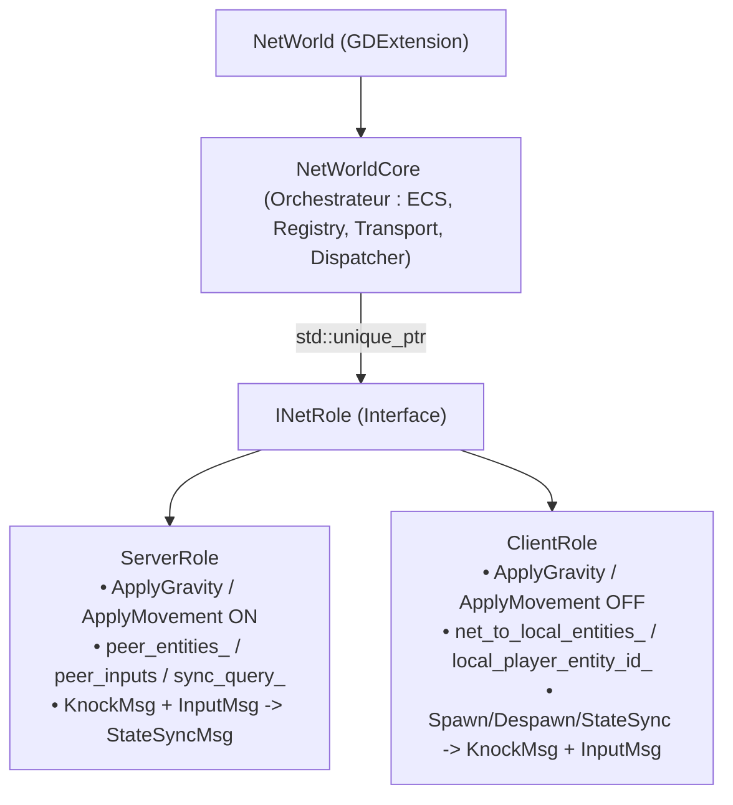

# Devlog #05 — Propriété Locale (`is_local`) & Séparation des Rôles (`INetRole`)

| Métadonnées | Détails |
| :--- | :--- |
| **Date** | `2026-11-18` |
| **Heure (Début → Fin)** | `13:43` → `21:45` *(bloc 1 : `13:43`–`14:10` ; bloc 2 : `15:49`–`21:45`, build validé à `21:30`)* |
| **Temps passé** | `~6h 25m` *(à ajuster selon pauses éventuelles)* |
| **Branche / Commit** | `network-logic` (`786fdd2`) |
| **Statut de fin de session** | 🟢 Compilable & Fonctionnel |

---

## 1. Contexte & Objectifs de la session
> *Où j'en étais en ouvrant le projet aujourd'hui, et qu'est-ce que je voulais accomplir pendant cette session ?*

En reprenant après la session #04 (`c6e3a33` / `570a876`), les inputs joueur autoritaires (`InputMsg`), le keepalive UDP (`KnockMsg`) et le cycle spawn/despawn multi-clients fonctionnaient, mais deux limites freinaient la suite (notamment l'interpolation côté client) :
1. Le client ne savait pas quelle entité lui appartenait parmi les cubes spawnés.
2. `NetWorldCore` mélangeait toute la logique serveur et client derrière un booléen `is_server_`, et exécutait les mêmes systèmes Flecs (`ApplyGravity`, `ApplyMovement`) des deux côtés.

- [x] Identifier l'entité locale du joueur côté client (`is_owner` / `is_local`) pour la distinguer visuellement et y attacher la caméra (`0e9d35c`)
- [x] Créer l'interface `INetRole` pour abstraire le rôle réseau dans `NetWorldCore` (`cd8a621`)
- [x] Implémenter `ServerRole` et `ClientRole` avec cycle de vie complet (`on_start`, `on_stop`, `on_egress`, événements pairs) et activation sélective des systèmes Flecs (`98bfd4b`)
- [x] Refactorer `NetWorldCore` en orchestrateur léger déléguant au rôle actif et sécuriser l'ordre des signaux Godot (`786fdd2`)

---

## 2. Ce qui a été fait (Résumé des changements)
> *Liste claire des fonctionnalités ajoutées, modifiées ou supprimées.*

### Fichiers touchés
- `src/core/NetMessage.h` (`0e9d35c`) :
  - Ajout de `bool is_owner = false;` dans `SpawnEntityMsg`, sérialisé/désérialisé avec `write_bool()` / `read_bool()`.
- `src/core/NetComponent.h` (`0e9d35c`) :
  - Ajout de `bool is_local = false;` dans `EntitySpawnEntry`.
- `src/core/INetRole.h` (`cd8a621`) :
  - Nouvelle interface abstraite `INetRole` définissant `on_start`, `on_stop`, `on_peer_connected`, `on_peer_disconnected`, `on_egress`, ainsi que `set_client_input` et `get_local_entity_id()` (avec implémentations par défaut neutres).
- `src/core/ServerRole.h` & `src/core/ServerRole.cpp` (`98bfd4b`) :
  - Extraction de tout l'état et de la logique serveur : `peer_entities_`, `peer_inputs`, `sync_query_` (requête Flecs cachée `<Position3D, Velocity3D>` avec `Networked`), `server_player_entity_id_` et `extract_batch()`.
  - `on_start()` : active la simulation Flecs (`core.set_simulation_systems_enabled(true)`), enregistre les handlers `KnockMsg` et `InputMsg`, construit `sync_query_` et crée `ServerPlayer`.
  - `on_stop()` : détruit proprement toutes les entités des pairs et `ServerPlayer`, et pousse leurs IDs dans `despawned_entities_`.
  - `on_peer_connected()` : crée l'entité du nouveau pair, lui envoie toutes les entités existantes avec `is_owner = (e.id() == new_entity_id)`, puis notifie les autres pairs avec `is_owner = false`.
  - `on_peer_disconnected()` & `on_egress()` : nettoyage + broadcast `DespawnEntityMsg`, et extraction/broadcast des `StateSyncMsg`.
- `src/core/ClientRole.h` & `src/core/ClientRole.cpp` (`98bfd4b`) :
  - Extraction de tout l'état et de la logique client : `net_to_local_entities_`, `input_client_`, `local_player_entity_id_`, `last_received_tick_` et `apply_batches()`.
  - `on_start()` : désactive les systèmes de simulation locaux (`core.set_simulation_systems_enabled(false)`), enregistre les handlers `StateSyncMsg`, `SpawnEntityMsg` (avec suivi de `local_player_entity_id_` si `msg.is_owner`) et `DespawnEntityMsg` (avec reset de `local_player_entity_id_` si l'entité locale disparaît), et envoie le `KnockMsg` initial.
  - `on_stop()` : détruit les entités répliquées, notifie `despawned_entities_` et réinitialise tous les champs client.
  - `on_egress()` : envoie le keepalive `KnockMsg` toutes les 60 frames et le `InputMsg` chaque frame.
- `src/core/NetworldCore.h` & `src/core/NetworldCore.cpp` (`0e9d35c`, `786fdd2`) :
  - Refactoring majeur (`-253` lignes) : suppression de `is_server_`, des maps spécifiques aux rôles, de `sync_query_`, `extract_batch()` et `apply_batches()`.
  - Remplacement par `std::unique_ptr<INetRole> role_` et ajout de `stop()` (appelé dans `~NetWorldCore()`, `start_host()` et `start_client()`).
  - Ajout de `set_simulation_systems_enabled(bool)` pour activer/désactiver `ApplyGravity` et `ApplyMovement` dans Flecs selon le rôle.
  - Exposition d'accesseurs contrôlés pour les rôles (`get_transport()`, `get_dispatcher()`, `get_registry()`, `get_current_tick()`, `push_spawned_entity()`, `push_despawned_entity()`), et délégation de `set_client_input()` / `get_local_entity_id()` à `role_`.
  - Vérification du retour de `transport_->open_as_host()` / `open_as_client()` avant d'instancier et démarrer le rôle.
- `src/godot/Networld.cpp` (`0e9d35c`, `786fdd2`) :
  - Ajout du paramètre `is_local` (`Variant::BOOL`) sur le signal `entity_spawned`.
  - Inversion de l'ordre d'émission dans `_process()` : `entity_despawned` est maintenant émis **avant** `entity_spawned`.
- `demo/test_networld.gd` (`0e9d35c`) :
  - Passage de `camera` en variable membre et ajout de `local_entity_id`.
  - Dans `_on_entity_spawned(entity_id, pos, is_local)` : coloration du cube local en bleu (`StandardMaterial3D` `Color(0.2, 0.6, 1.0)`) et attachement de la caméra (`camera.reparent(cube, false)`).
  - Dans `_on_entity_despawned(entity_id)` : détachement préventif de la caméra (`camera.reparent(self, false)`) avant `cube.queue_free()` si le cube local est supprimé.

### Explication du fonctionnement
- **Propriété locale de bout en bout :** À la connexion d'un client, `ServerRole::on_peer_connected()` marque uniquement le `SpawnEntityMsg` correspondant à son propre avatar avec `is_owner = true`. `ClientRole` stocke l'ID local dans `local_player_entity_id_` et remonte `is_local` via `EntitySpawnEntry` → signal Godot `entity_spawned(entity_id, pos, is_local)` → `test_networld.gd` qui colore le cube et y reparente la caméra.
- **Orchestration par rôles (`INetRole`) :** `NetWorldCore` conserve uniquement le socle commun (monde Flecs, registre de composants, transport, `PacketDispatcher`, horloge `current_tick_`, et tampons de synchronisation vers le moteur). Dans `step()`, il exécute le flux générique *Ingress → `ecs_.progress()` → `role_->on_egress()`*, tandis que chaque rôle gère ses propres handlers réseau, ses tables d'entités et l'activation des systèmes Flecs.

---

## 3. Choix Techniques & Architecture (Le "Pourquoi")
> *Pourquoi avoir codé ça de cette manière plutôt qu'une autre ? Quels compromis (performance, lisibilité, découplage) ont été faits ?*

- **Décision 1 : Pattern Strategy (`INetRole` + `std::unique_ptr<INetRole>`) plutôt qu'un héritage de `NetWorldCore`**
  - *Alternative envisagée :* Faire hériter `ServerNetWorldCore` et `ClientNetWorldCore` de `NetWorldCore`, ou conserver des `if (is_server_)` partout.
  - *Raison du choix :* `NetWorld` (singleton Godot) possède un unique `NetWorldCore core_` qui peut démarrer comme Host ou Client au runtime (et basculer/redémarrer via `stop()`). Isoler la logique dans `INetRole` garde `NetWorldCore` stable en tant que façade tout en supprimant complètement les états morts (un serveur n'alloue plus `net_to_local_entities_`, un client n'alloue plus `peer_entities_` ni `sync_query_`).
- **Décision 2 : Désactiver `ApplyGravity` et `ApplyMovement` côté `ClientRole`**
  - *Alternative envisagée :* Laisser les systèmes de simulation tourner localement sur le client entre deux `StateSyncMsg`.
  - *Raison du choix :* Tant qu'il n'y a pas encore de réconciliation/prédiction contrôlée, faire tourner la physique des deux côtés créait une double intégration et des micro-écarts avec l'état serveur. Désactiver la simulation côté client fait de `StateSyncMsg` la source directe et prépare un terrain propre pour ajouter un système dédié d'interpolation visuelle côté client.
- **Décision 3 : Flag `is_owner` directement dans `SpawnEntityMsg` plutôt qu'un paquet `WelcomeMsg` séparé**
  - *Alternative envisagée :* Ajouter un `PacketId::WELCOME` contenant le `local_entity_id` du joueur.
  - *Raison du choix :* Sur UDP sans garantie d'ordre stricte, un `WelcomeMsg` pourrait arriver avant le `SpawnEntityMsg` correspondant, obligeant à gérer un état d'attente. Porter `is_owner` directement dans `SpawnEntityMsg` rend l'information atomique au moment même où l'entité est créée côté client.
- **Décision 4 : Émettre `entity_despawned` avant `entity_spawned` dans `NetWorld::_process()`**
  - *Alternative envisagée :* Garder l'ancien ordre (`entity_spawned` puis `entity_despawned`).
  - *Raison du choix :* Avec l'arrivée de `stop()` / `on_stop()` (lors d'un redémarrage Host/Client) ou si Flecs recycle un ID d'entité dans la même frame, traiter d'abord les destructions garantit que les anciens `MeshInstance3D` (et le reparentage caméra) sont nettoyés avant de créer les nouvelles vues.

### Schéma / Flux

---

## 4. Problèmes rencontrés & Solutions (Debugging)
> *Qu'est-ce qui a posé problème ou fait perdre du temps aujourd'hui, et comment ça a été résolu ?*

- **Risque 1 : Destruction accidentelle de la caméra lors du despawn du cube local**
  - *Cause :* En reparentant `camera` sous le `MeshInstance3D` du joueur local (`camera.reparent(cube, false)`), un appel à `cube.queue_free()` dans `_on_entity_despawned()` détruirait aussi la `Camera3D` enfant.
  - *Solution :* Suivi de `local_entity_id` dans `test_networld.gd` et reparentage préventif vers la racine (`camera.reparent(self, false)`) avant de libérer le cube.
- **Risque 2 : Nettoyage des entités et handlers lors d'un arrêt ou redémarrage de session**
  - *Cause :* Avant l'introduction de `stop()` et `INetRole::on_stop()`, relancer `start_host()` ou `start_client()` réinitialisait les maps sans détruire les anciennes entités Flecs ni notifier Godot de leur disparition.
  - *Solution :* Ajout de `NetWorldCore::stop()` (appelant `role_->on_stop(*this)`, réinitialisant `packet_dispatcher_` et fermant le transport) combiné à l'émission de `entity_despawned` avant `entity_spawned` dans `NetWorld::_process()`.

---

## 5. Où j'en suis & Prochaine Session (Reprise rapide)
> *LA section à relire en premier la prochaine fois que j'ouvre le projet !*

- **État exact du code en quittant :**
  - Branche `network-logic`, commit `786fdd2` propre (aucune modification non commitée).
  - Les binaires Windows (`template_debug` et `template_release`) compilent sans erreur (`21:30`).
  - L'architecture `NetWorldCore` + `INetRole` (`ServerRole` / `ClientRole`) est en place, la simulation Flecs est désactivée côté client, et le joueur local est identifié (`is_local`), coloré en bleu et suivi par la caméra.
- **Prochaines étapes immédiates (TODO de reprise) :**
  1. [ ] Mettre en place l'interpolation visuelle côté client (`ClientRole`) entre deux `StateSyncMsg` (buffer de snapshots / cible de position + système d'interpolation côté client uniquement).
  2. [ ] Faire un mini-nettoyage post-split : ajouter `#include <cmath>` explicitement dans `src/core/ServerRole.cpp` (pour `std::sqrt`), retirer `#include <cmath>` / `#include "NetMessage.h"` / `#include <unordered_map>` inutilisés dans `NetworldCore.cpp` / `NetworldCore.h`, et sortir la vitesse serveur (`5.0f`) en constante/composant propre.
  3. [ ] Ajouter la synchronisation de la rotation (`SpawnEntityMsg::rotation` + composant `Rotation3D`) et décider si le Host doit aussi pouvoir contrôler son propre cube (mode Listen-Server).
  4. [ ] Exposer `get_local_entity_id()` côté GDScript dans `NetWorld::_bind_methods()` si nécessaire pour les scripts utilisateur.
- **Idées / Questions mises de côté pour plus tard :**
  - Évaluer le `TODO` dans `ServerRole::on_stop()` : détruire toutes les entités portant le tag `Networked` via une requête Flecs (utile dès qu'il y aura des entités non-joueurs comme des projectiles ou PNJ).
  - Implémenter une vraie couche de fiabilité (ACK / resend) pour `NetChannel::RELIABLE_EVENTS` afin que `SpawnEntityMsg` et `DespawnEntityMsg` ne puissent pas être perdus sur UDP réel.
  - Ajouter un garde `std::isfinite` côté serveur sur les `Vec3` reçus dans `InputMsg` pour rejeter d'éventuels `NaN` / `Inf`.
  - Vérification `reader.empty()` dans `PacketDispatcher` en mode debug.
