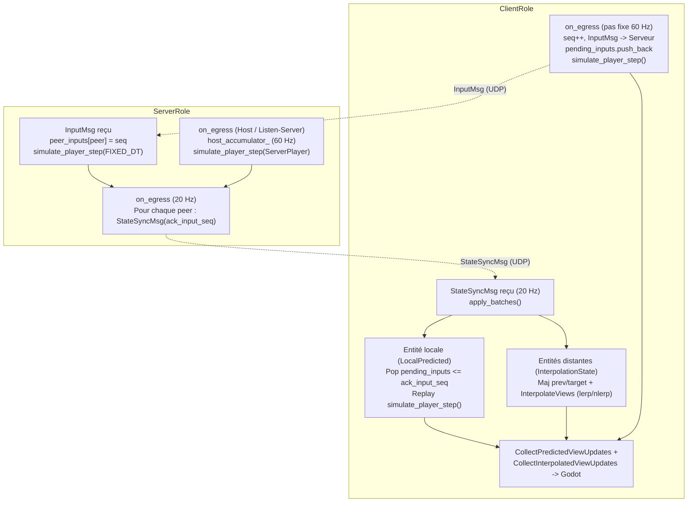

# Devlog #06 — Interpolation (20 Hz), Rotation (`Quat`), Prédiction/Réconciliation & Mode Host

| Métadonnées | Détails |
| :--- | :--- |
| **Date** | `2026-11-19` |
| **Heure (Début → Fin)** | `~09:30` → `20:46` *(bloc 1 : `~09:30`–`12:15`, 1er commit `09:52` ; pause : `12:15`–`16:00` ; bloc 2 : `16:00`–`20:46`)* |
| **Temps passé** | `~7h 30m` *(bloc 1 `~2h 45m` + bloc 2 `4h 46m`, à ajuster selon l'heure exacte de début le matin)* |
| **Branche / Commit** | `network-logic` (`fea16ea`) |
| **Statut de fin de session** | 🟢 Compilable & Fonctionnel |

---

## 1. Contexte & Objectifs de la session
> *Où j'en étais en ouvrant le projet aujourd'hui, et qu'est-ce que je voulais accomplir pendant cette session ?*

En reprenant après la session #05 (`786fdd2`), la séparation `ServerRole` / `ClientRole` via `INetRole` était en place et la simulation Flecs désactivée côté client, mais les entités côté client se téléportaient à chaque `StateSyncMsg` (émis à chaque frame sans cadence), la rotation n'était pas encore synchronisée, le joueur local subissait toute la latence aller-retour, et le Host ne pouvait pas encore contrôler son propre cube.

- [x] Cadencer l'envoi des `StateSyncMsg` (`NET_SYNC_INTERVAL`), sécuriser les inputs (`std::isfinite`) et nettoyer les includes / constantes post-split (`d0567a9`, `e7965d6`)
- [x] Implémenter l'interpolation visuelle côté client (`InterpolationState` + systèmes Flecs `InterpolateViews` et `CollectInterpolatedViewUpdates`) (`35cf95a`, `cd1a4eb`)
- [x] Ajouter la synchronisation et l'interpolation complète de la rotation en quaternions (`Quat`, `Rotation3D`, `StreamWriter`/`StreamReader`, `nlerp`, rendu Godot + « nez » directionnel) (`4b4697d`, `4c868e5`, `c02b032`)
- [x] Implémenter la prédiction côté client et la réconciliation serveur (`MovementSim.h`, `LocalPredicted`, `ack_input_seq`, boucle à pas fixe `FIXED_DT` + replay de `pending_inputs`) (`1c0ea77`, `e98689d`, `2205fe9`)
- [x] Permettre le contrôle de l'entité locale côté Host (mode Listen-Server) (`fea16ea`)

---

## 2. Ce qui a été fait (Résumé des changements)
> *Liste claire des fonctionnalités ajoutées, modifiées ou supprimées.*

### Fichiers touchés
- `src/core/INetRole.h` (`d0567a9`, `e7965d6`) :
  - Ajout de la constante globale `NET_SYNC_INTERVAL` (d'abord `0.2f` à 5 Hz pour tester visuellement l'interpolation, puis passée à `1.0f / 20.0f` = 20 Hz).
  - Passage de `delta_time` dans la signature de `INetRole::on_egress(NetWorldCore& core, float delta_time)`.
- `src/core/MovementSim.h` *(nouveau)* (`1c0ea77`) :
  - Extraction d'une fonction déterministe partagée client/serveur : `simulate_player_step(Vec3& pos, Quat& rot, const Vec3& raw_dir, float dt)` avec constantes `FIXED_DT` (60 Hz), `PLAYER_MOVE_SPEED` (`5.0f`) et `PLAYER_TURN_SPEED` (`12.0f`).
  - Inclut garde `std::isfinite`, normalisation du vecteur d'entrée, déplacement linéaire et rotation fluide par `Quat::nlerp` vers le yaw cible (`std::atan2`).
- `src/core/NetComponent.h` (`35cf95a`, `4b4697d`, `1c0ea77`) :
  - Ajout de `Vec3::operator-` et `Vec3::lerp()`.
  - Ajout de `struct Quat` (`normalized()`, `from_yaw/pitch/roll()`, `nlerp()` avec gestion du plus court chemin quand `dot < 0`) et du composant POD `Rotation3D`.
  - Ajout du composant client `InterpolationState` (`prev/target/visual` pour position et rotation, `elapsed`, `duration`) et du tag `LocalPredicted`.
  - Ajout du champ `Quat rotation` dans `ViewUpdate` et `EntitySpawnEntry`.
- `src/core/StreamWriter.h/.cpp` & `src/core/StreamReader.h/.cpp` (`4b4697d`) :
  - Ajout de `write_quat()` et `read_quat()` (4 floats `x, y, z, w`).
- `src/core/NetMessage.h` (`4b4697d`, `1c0ea77`) :
  - `SpawnEntityMsg::rotation` passe de `Vec3` à `Quat`.
  - Ajout de `uint64_t ack_input_seq = 0;` dans `StateSyncMsg` (sérialisé/désérialisé) pour acquitter le dernier input appliqué par le serveur pour un pair donné.
- `src/core/NetworldCore.h/.cpp` (`d0567a9`, `cd1a4eb`, `4c868e5`, `e98689d`) :
  - Enregistrement de `Rotation3D` dans `ComponentRegistry` (ID `13`) et de ses métadonnées Flecs (`Quat`, `Rotation3D`) ; ajout de `Rotation3D` dans `create_networked_entity()` et de `set_entity_rotation()`.
  - Ajout des systèmes Flecs dédiés au client : `InterpolateViews` (`OnUpdate`, `Vec3::lerp` + `Quat::nlerp`), `CollectInterpolatedViewUpdates` (`PostUpdate`) et `CollectPredictedViewUpdates` (`PostUpdate`, `.with<LocalPredicted>()`).
  - Passage de `CollectViewUpdates` en `flecs::PostUpdate` avec extraction de `Rotation3D`.
  - Refactoring de l'activation des systèmes via `set_system_enabled(name, enabled)`, `set_simulation_systems_enabled()` et `set_interpolation_systems_enabled()`.
  - Nettoyage des includes inutilisés (`<cmath>`, `"NetMessage.h"`, `<unordered_map>`).
- `src/core/ServerRole.h/.cpp` (`d0567a9`, `cd1a4eb`, `4b4697d`, `4c868e5`, `e98689d`, `2205fe9`, `fea16ea`) :
  - Ajout de `#include <cmath>` et de `sync_accumulator_` pour n'émettre les `StateSyncMsg` qu'à la cadence `NET_SYNC_INTERVAL`.
  - `sync_query_` inclut désormais `Rotation3D` ; `on_peer_connected()` envoie la vraie rotation des entités existantes dans `SpawnEntityMsg`.
  - Le handler `InputMsg` utilise désormais `simulate_player_step(..., FIXED_DT)`.
  - Dans `on_egress()`, remplacement du `PEER_BROADCAST` par une boucle par pair connecté afin d'injecter le bon `ack_input_seq` propre à chaque client.
  - Ajout du support **Listen-Server (Host jouable)** : `host_input_`, `host_accumulator_`, overrides de `set_client_input()` et `get_local_entity_id()`, spawn de `ServerPlayer` avec `is_local = true` et simulation à pas fixe `FIXED_DT` dans `on_egress()`.
- `src/core/ClientRole.h/.cpp` (`d0567a9`, `35cf95a`, `cd1a4eb`, `4c868e5`, `2205fe9`, `fea16ea`) :
  - Séparation nette au spawn (`SpawnEntityMsg`) : l'entité locale (`is_owner == true`) reçoit le tag `LocalPredicted`, tandis que les entités distantes reçoivent `InterpolationState`.
  - Interpolation des entités distantes sur `StateSyncMsg` avec seuil de téléportation `SNAP_DIST = 100.0f` (distance au carré).
  - Prédiction & Réconciliation pour l'entité locale : accumulateur `fixed_accumulator` à pas fixe (`FIXED_DT`, clamp `delta_time <= 0.25s`), file `std::deque<PendingInput> pending_inputs` (capée à 128), incrémentation de `next_input_seq`, simulation locale immédiate dans `on_egress()`, puis à la réception d'un `StateSyncMsg` : `apply_batches()` → purge des inputs acquittés (`seq <= msg.ack_input_seq`) → rejeu (`replay`) des inputs non encore acquittés via `simulate_player_step()`.
- `src/godot/Networld.h/.cpp` (`cd1a4eb`, `c02b032`) :
  - Exposition de `get_local_entity_id()` à GDScript et appel de `core_.stop()` dans `host()` et `join()`.
  - Ajout du paramètre `rotation` dans `ADD_SIGNAL("entity_spawned", ...)` et application de la rotation dans `_process()` via `node->set_global_basis(Basis(Quaternion(...)))`.
- `demo/test_networld.gd` (`c02b032`, `fea16ea`) :
  - Ajout d'un petit cube rouge (« nez » à `z = 0.6`) enfant de chaque cube pour visualiser clairement son orientation.
  - Remplacement du reparentage de la caméra par un suivi par position dans `_process()` (`views[local_entity_id].position + Vector3(0, 7, 10)`) pour éviter que la caméra ne tourne avec le joueur.
  - Remplacement de `if not is_client:` par `if local_entity_id == 0:` pour que le Host contrôle aussi son cube local.

### Explication du fonctionnement
- **Deux chemins de rendu côté client :**
  1. **Entités distantes (`InterpolationState`)** : les snapshots serveur arrivent à 20 Hz (`NET_SYNC_INTERVAL`). `StateSyncMsg` met à jour `prev -> target` (ou snap si l'écart dépasse `SNAP_DIST`), `InterpolateViews` calcule `visual_pos` (`lerp`) et `visual_rot` (`nlerp`) chaque frame, et `CollectInterpolatedViewUpdates` pousse le résultat vers Godot.
  2. **Entité locale (`LocalPredicted`)** : aucune interpolation de retard. À chaque pas fixe `FIXED_DT` (60 Hz), le client envoie `InputMsg{seq, dir}`, le stocke dans `pending_inputs` et applique tout de suite `simulate_player_step()`. Quand le serveur renvoie un `StateSyncMsg` contenant `ack_input_seq`, le client écrase sa position/rotation par la vérité serveur (`apply_batches`), retire tous les inputs `<= ack_input_seq`, puis rejoue instantanément les inputs encore en vol. `CollectPredictedViewUpdates` pousse la pose prédite vers Godot.
- **Rotation fluide unifiée :** grâce à `MovementSim.h`, serveur et client exécutent exactement la même fonction (`simulate_player_step`) avec le même `FIXED_DT`, ce qui assure à la fois une rotation progressive (`PLAYER_TURN_SPEED`) côté serveur (plus de snap brusque) et une réconciliation quasi sans dérive côté client.

---

## 3. Choix Techniques & Architecture (Le "Pourquoi")
> *Pourquoi avoir codé ça de cette manière plutôt qu'une autre ? Quels compromis (performance, lisibilité, découplage) ont été faits ?*

- **Décision 1 : Représenter la rotation en `Quat` plutôt qu'en angles d'Euler (`Vec3`)**
  - *Alternative envisagée :* Garder `Vec3 rotation` (Euler) dans `SpawnEntityMsg` et les composants.
  - *Raison du choix :* Les quaternions évitent le gimbal lock et le problème de discontinuité à `±π` lors de l'interpolation, se sérialisent en POD contigu (4 floats) pour le SoA, et s'interpolent proprement via `Quat::nlerp` (avec inversion de signe si `dot < 0` pour garantir le plus court chemin).
- **Décision 2 : Header partagé `MovementSim.h` + pas fixe `FIXED_DT` (1/60 s)**
  - *Alternative envisagée :* Laisser la physique tourner avec des `delta_time` variables de chaque côté (Godot `_process` / `ApplyMovement` serveur).
  - *Raison du choix :* Pour que la prédiction client converge avec l'autorité serveur sans micro-corrections permanentes, les deux côtés doivent intégrer exactement le même pas de temps (`FIXED_DT`) et la même formule (`simulate_player_step`), avec un clamp de `delta_time` à `0.25f` contre la spirale de la mort en cas de freeze.
- **Décision 3 : Envoi de `StateSyncMsg` par pair (unicast) au lieu d'un unique `PEER_BROADCAST`**
  - *Alternative envisagée :* Garder un seul paquet broadcasté contenant une map `(peer_id -> ack_seq)` pour tous les joueurs.
  - *Raison du choix :* Envoyer un `StateSyncMsg` par client avec son propre `ack_input_seq` garde le format du paquet simple, constant en taille et évite de diffuser à chaque client les séquences d'acquittement des autres joueurs. (À terme, les octets `soa_buffer` pourront être sérialisés une seule fois avant la boucle d'envoi pour économiser du CPU.)
- **Décision 4 : Suivi caméra par position plutôt que reparentage sous le cube joueur**
  - *Alternative envisagée :* Garder `camera.reparent(cube, false)` introduit en session #05.
  - *Raison du choix :* Dès que la rotation du cube a été appliquée via `set_global_basis()`, une caméra enfant tournait avec le cube de manière désorientante. Suivre uniquement `cube.position + Vector3(0, 7, 10)` garde une caméra top-down/isométrique stable et supprime en prime le risque de destruction de la caméra au despawn.

### Schéma / Flux (Prédiction & Réconciliation vs Interpolation)

---

## 4. Problèmes rencontrés & Solutions (Debugging)
> *Qu'est-ce qui a posé problème ou fait perdre du temps aujourd'hui, et comment ça a été résolu ?*

- **Problème 1 : Sensation « clunky » / latence perceptible sur le joueur local avec l'interpolation seule (`cd1a4eb`)**
  - *Cause :* En interpolant aussi l'entité du joueur local sur des snapshots à 5 Hz puis 20 Hz, les touches avaient un délai visible (RTT + fenêtre d'interpolation).
  - *Solution :* Séparation en deux catégories côté client : `InterpolationState` uniquement pour les entités distantes, et prédiction + réconciliation (`LocalPredicted` + `pending_inputs` + `ack_input_seq`) pour l'entité locale.
- **Problème 2 : Erreur de condition dans `InterpolateViews` (`cd1a4eb` → corrigé en `4c868e5`)**
  - *Cause :* Le calcul du facteur `t` testait `interp.elapsed > 0.0f` au lieu de `interp.duration > 0.0f` (risque de division par zéro si `duration == 0` et snap initial à `1.0f` quand `elapsed == 0`).
  - *Solution :* Corrigé en `float t = interp.duration > 0.0f ? std::clamp(interp.elapsed / interp.duration, 0.0f, 1.0f) : 1.0f;`.
- **Problème 3 : Mauvaise map comparée lors de la récupération de `ack_input_seq` (`e98689d` → corrigé en `2205fe9`)**
  - *Cause :* Dans `ServerRole::on_egress()`, `auto it = peer_inputs.find(peer_id);` était comparé à `peer_entities_.end()` au lieu de `peer_inputs.end()` (comportement indéfini sur itérateurs de conteneurs différents).
  - *Solution :* Corrigé en `(it != peer_inputs.end()) ? it->second : 0;` dans `2205fe9`.
- **Problème 4 : Rotation par « snap » instantané côté serveur (`c02b032`)**
  - *Cause :* Le serveur appliquait directement `Quat::from_yaw(yaw)` à la réception de l'input.
  - *Solution :* Intégration de `Quat::nlerp(rot, Quat::from_yaw(yaw), std::min(1.0f, PLAYER_TURN_SPEED * dt))` dans `simulate_player_step()` (`1c0ea77`).

---

## 5. Où j'en suis & Prochaine Session (Reprise rapide)
> *LA section à relire en premier la prochaine fois que j'ouvre le projet !*

- **État exact du code en quittant :**
  - Branche `network-logic`, commit `fea16ea` propre (aucune modification non commitée).
  - Les binaires Windows (`template_debug` et `template_release`) compilent sans erreur (`20:39`).
  - Pipeline réseau complet fonctionnel : sync 20 Hz, interpolation position + rotation (`Quat`) pour les entités distantes, prédiction 60 Hz + réconciliation (`ack_input_seq`) pour le joueur local, et Host jouable en mode Listen-Server.
- **Prochaines étapes immédiates (TODO de reprise) :**
  1. [X] **Corriger deux petits bugs repérés à la relecture :**
     - Dans `src/core/ClientRole.cpp` (L52) : `if (pos || rot)` doit être `if (pos && rot)` pour éviter un déréférencement nul si un des composants manque.
     - Dans `src/godot/Networld.cpp` (L58–62 vs L165) et `demo/test_networld.gd` (L47) : `ADD_SIGNAL("entity_spawned", ...)` déclare 4 paramètres `(entity_id, position, rotation, is_local)`, alors que `emit_signal` et `_on_entity_spawned` n'en passent/reçoivent encore que 3 — aligner la signature pour transmettre la rotation initiale dès le spawn.
  2. [ ] **Décision d'architecture Serveur Dédié vs Listen-Server (Host) :** clarifier si le serveur reste toujours un Listen-Server (avec joueur local) ou s'il faut distinguer explicitement deux modes (`DedicatedServer` vs `Host` / Listen-Server), et nettoyer le code commenté dans `ServerRole.cpp` / `ClientRole.cpp`.
  3. [ ] **Harmoniser physique Flecs (`ApplyGravity`/`ApplyMovement`) et `simulate_player_step()` :** actuellement le serveur exécute toujours `ApplyGravity`/`ApplyMovement` sur `Velocity3D` alors que `simulate_player_step` modifie directement `Position3D` (et ne tourne pas encore la gravité côté prédiction client).
  4. [ ] **Concevoir la fiabilité sur `RELIABLE_EVENTS` (ACK / resend)** pour garantir que `SpawnEntityMsg` et `DespawnEntityMsg` ne puissent pas être perdus sur UDP réel.
- **Idées / Questions mises de côté pour plus tard :**
  - Optimiser `ServerRole::on_egress()` en sérialisant les `NetBatch` (SoA) une seule fois avant la boucle sur les pairs, au lieu de ré-encoder les batches pour chaque client.
  - Lisser les éventuelles corrections de réconciliation client (error smoothing / visual offset decay) lorsque le réseau a de la perte de paquets ou du jitter.
  - Envisager un buffer de snapshots avec un léger délai d'interpolation (ex. 2 × `NET_SYNC_INTERVAL`) pour résister au jitter réseau sur les entités distantes.
  - `TODO` dans `ServerRole.h` : prévoir l'option pour des IDs 32 vs 64 bits selon le besoin, et nettoyage générique des entités `Networked` dans `ServerRole::on_stop()`.
