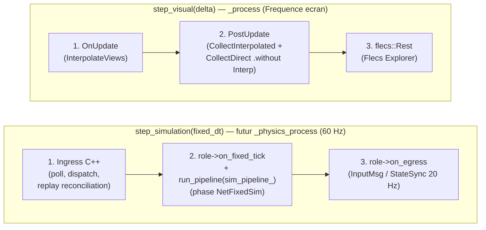

# Devlog #07 — Architecture v0.1.0, Contrats de Données (1A) & Refonte `NetWorldCore` (1B)

| Métadonnées | Détails |
| :--- | :--- |
| **Date** | `2026-11-21` |
| **Heure (Début → Fin)** | `10:00` → `18:42` *(pause déjeuner : `45m`)* |
| **Temps passé** | `~7h 55m` |
| **Branche / Commit** | `step-1` (`e1f49f1`) |
| **Statut de fin de session** | 🟡 Compilable (WIP Étape 1 : 1A + 1B terminées, 1C → 1F à venir) |

---

## 1. Contexte & Objectifs de la session
> *Où j'en étais en ouvrant le projet aujourd'hui, et qu'est-ce que je voulais accomplir pendant cette session ?*

Après la session #06 (`fea16ea`), le pipeline réseau de prototypage tournait de bout en bout, mais la frontière entre le cœur de librairie (`src/core/`) et le gameplay de démo (`ServerPlayer`, auto-spawn à la connexion, `MovementSim.h`, `Vec3` d'input figé) commençait à poser problème pour la suite. L'objectif du jour était de prendre du recul pour poser l'architecture cible **v0.1.0**, figer les contrats techniques de l'Étape 1, puis démarrer proprement le découplage du Core sur une nouvelle branche `step-1`.

- [x] Conceptualiser et valider la faisabilité des 3 axes majeurs : DGS vs Listen-Server sans gameplay dans le Core, Gameplay Framework C++ à la Unreal, et interface physique `INetPhysics` via `PhysicsServer3D` (`4e8f176`)
- [x] Figer le plan directeur et la feuille de route en 4 étapes dans `devlog/ARCHITECTURE_V0_1.md` (écosystème en 3 repos publics : `Networld`, `GodotNetworld`, `QuicNetworkGodot`) (`4e8f176`)
- [x] Verrouiller les 4 contrats précis de l'Étape 1 : `Peer`/`Ownership`, `WelcomeMsg`/`SpawnParams`, `InputPayload` générique + step unitaire rejouable, et 2 pipelines Flecs (`step_simulation`/`step_visual`) (`a1d2a9b`)
- [x] Implémenter la **sous-étape 1A** : nouveaux types, composants POD, messages réseau et contrat `INetRole` (`400b1e8`)
- [x] Implémenter la **sous-étape 1B** : refonte complète de `NetWorldCore` (2 pipelines Flecs, registre de simulateurs, cycle de vie entités/pairs, suppression de la physique de démo) (`667dc07`)
- [x] Poser des stubs temporaires (`TODO(1C/1D/1E)`) sur `ServerRole`, `ClientRole` et `NetWorld` pour terminer la session sur une DLL `template_debug` compilable à 0 erreur (`e1f49f1`)

---

## 2. Ce qui a été fait (Résumé des changements)
> *Liste claire des fonctionnalités ajoutées, modifiées ou supprimées.*

### Fichiers touchés
- `devlog/ARCHITECTURE_V0_1.md` *(nouveau)* (`4e8f176`, `a1d2a9b`) :
  - Document d'architecture complet de la v0.1.0 : découpage en 3 dépôts (`Networld`, `GodotNetworld`, `QuicNetworkGodot`), architecture 3 couches (Core C++20 pure → Briques Godot → Gameplay Framework C++ avec `GDVIRTUAL`), intégration QUIC (`ngtcp2` + `BoringSSL` + dual-stack), physique cinématique via `INetPhysics` / `PhysicsServer3D`, feuille de route en 4 étapes et les 4 contrats validés de l'Étape 1.
- `src/core/INetTransport.h` (`400b1e8`) :
  - Ajout de `PEER_NONE = 0` pour distinguer l'ownership monde/serveur de `PEER_SERVER = 1` (Host local en Listen-Server) et des clients distants (`>= 2`).
- `src/core/MovementSim.h` (`400b1e8`) :
  - Retrait de `FIXED_DT` (déplacé dans `INetRole.h` en préparation de la sortie de `MovementSim.h` hors de `src/core/` en 1E).
- `src/core/NetComponent.h` (`400b1e8`) :
  - Ajout des composants POD `NetType { uint32_t type_id }`, `NetOwnership { uint32_t owner_peer_id }` et `NetEntityID { uint64_t server_id }`.
  - Enrichissement de `EntitySpawnEntry` (`type_id`, `owner_peer_id`, `entity_id`, `position`, `is_local`, `rotation`).
  - Ajout de `SpawnParams`, `PeerEvent`, `SimContext` (avec référence `NetWorldCore& core` via *forward declaration* + `bool is_replay`), et de `InputPayload` (buffer inline fixe de 64 octets, 0 allocation heap, avec `from<T>()`, `read_as<T>() const`, `bytes()`, `from_bytes()`, `empty()`).
- `src/core/NetMessage.h` (`400b1e8`) :
  - Ajout de `PacketId::WELCOME` et `WelcomeMsg { uint32_t assigned_peer_id; uint32_t tick; }`.
  - Mise à jour de `SpawnEntityMsg` : `{ entity_Id, type_id, owner_peer_id, position, rotation, predicted }` (remplace `is_owner`).
  - Mise à jour de `InputMsg` : `{ uint64_t seq; uint64_t target_entity_id; InputPayload payload; }` avec sérialisation préfixée par `uint8_t size` bornée à `InputPayload::MAX_SIZE`.
- `src/core/INetRole.h` (`400b1e8`) :
  - Ajout de `FIXED_DT = 1.0f / 60.0f` et `enum class HostMode : uint8_t { DEDICATED, LISTEN }`.
  - Remplacement de `set_client_input(Vec3)` / `get_local_entity_id()` par `on_fixed_tick()`, `on_entity_spawned()`, `on_entity_despawned()`, `set_local_input(target_local_entity_id, payload)` et `get_local_peer_id() -> uint32_t`.
- `src/core/NetworldCore.h` & `src/core/NetworldCore.cpp` (`667dc07`) :
  - Suppression des systèmes de démo `ApplyGravity` / `ApplyMovement`, de `create_networked_entity()`, `set_simulation_systems_enabled()`, `set_interpolation_systems_enabled()`, `set_client_input()` et `get_local_entity_id()`.
  - Enregistrement de la réflexion Flecs pour `NetType`, `NetOwnership` et `NetEntityID`.
  - Création de la phase dédiée `NetFixedSim` et de son pipeline isolé `sim_pipeline_` (`ecs_.pipeline().with(flecs::System).with(fixed_sim_phase_).build()`).
  - Simplification des systèmes visuels toujours actifs : `InterpolateViews` (`OnUpdate`), `CollectInterpolatedViewUpdates` (`PostUpdate`), et collecte directe filtrée par `.without<InterpolationState>()` (`PostUpdate`).
  - Séparation de `step()` en `step_simulation(float delta_time)` (Ingress → `current_tick_++` → `on_fixed_tick` → `run_pipeline(sim_pipeline_)` → `on_egress`) et `step_visual(float delta_time)` (`view_updates_.clear()` → `ecs_.progress(delta_time)` conservant `flecs::Rest`).
  - Ajout de `start_host(port, HostMode)`, `create_local_entity()`, `spawn_networked_entity()`, `despawn_networked_entity()`, `destroy_entities_owned_by()`, `register_entity_simulator()`, `run_entity_simulator()`, `set_local_input()`, `get_local_peer_id()` et des files `connected_peers_` / `disconnected_peers_`.
- `src/core/ServerRole.h/.cpp`, `src/core/ClientRole.h/.cpp`, `src/godot/Networld.h/.cpp` (`e1f49f1`) :
  - Stubs et commentaires temporaires (`TODO(1C)`, `TODO(1D)`, `TODO(1E)`) sur les anciens appels pour conserver une compilation propre de la DLL debug avant d'attaquer 1C à la prochaine session.

### Explication du fonctionnement
- **Core découplé de tout gameplay :** `NetWorldCore` ne crée plus aucun joueur tout seul et n'exécute plus aucune physique codée en dur. Il expose des primitives neutres de spawn/despawn, des événements de session (`connected_peers_`, `disconnected_peers_`), et un registre `entity_simulators_[type_id]` appelable à la demande (`1×` par tick normal ou `N×` lors d'un replay de réconciliation avec `SimContext::is_replay = true`).
- **Deux boucles Flecs distinctes :** `step_simulation()` fait tourner le réseau et la phase `NetFixedSim` via `ecs_.run_pipeline(sim_pipeline_, dt)` (destiné à `_physics_process` côté Godot), tandis que `step_visual()` fait tourner `ecs_.progress(dt)` sur les seuls systèmes visuels (`InterpolateViews` + collecte des vues + serveur REST Flecs Explorer). L'absence ou la présence de `InterpolationState` sur chaque entité pilote automatiquement sa collecte visuelle sans activer/désactiver de systèmes par rôle.

---

## 3. Choix Techniques & Architecture (Le "Pourquoi")
> *Pourquoi avoir codé ça de cette manière plutôt qu'une autre ? Quels compromis (performance, lisibilité, découplage) ont été faits ?*

- **Décision 1 : `NetOwnership` en composant POD plutôt qu'en relation Flecs `(OwnedBy, peer_entity)`**
  - *Alternative envisagée :* Utiliser une relation Flecs `(OwnedBy, peer_entity)` pour l'ownership et le nettoyage en cascade.
  - *Raison du choix :* Sans `DontFragment`, une relation par pair fragmente les tables Flecs en autant d'archétypes que de joueurs (cassant l'extraction SoA par `std::memcpy`), et une relation ne se sérialise pas directement en colonne SoA. Un composant POD `uint32_t owner_peer_id` (4 octets) garde toutes les entités dans la même table SoA et autorise nativement le transfert d'ownership (ex. monter dans un véhicule).
- **Décision 2 : `InputPayload` en buffer fixe inline (64 octets) au lieu de `std::vector<uint8_t>`**
  - *Alternative envisagée :* Transporter les inputs génériques dans un `std::vector<uint8_t>`.
  - *Raison du choix :* À 60 Hz avec une file de réconciliation `pending_inputs` et une file serveur par joueur, un buffer inline `std::array<uint8_t, 64>` évite toute allocation heap dynamique par tick, reste cache-friendly et borne naturellement la taille des paquets d'input côté serveur (anti-DoS).
- **Décision 3 : Physique cinématique via `INetPhysics` / `PhysicsServer3D` en v0.1.0 (plutôt que rollback complet `RigidBody3D`)**
  - *Alternative envisagée :* Piloter un rollback complet de Jolt via `PhysicsServer3D::step()`.
  - *Raison du choix :* Vérification faite dans [physics_server3d.hpp](file:///c:/Users/leoul/Godot/Projects/Networld/godot-cpp/gen/include/godot_cpp/classes/physics_server3d.hpp#L267-L445) : `PhysicsServer3D` n'expose ni `step()`/`space_step()` ni `StateRecorder` Jolt en GDExtension. En revanche, `body_test_motion()` et `PhysicsDirectSpaceState3D` fonctionnent sans état global et permettent de rejouer `N` ticks cinématiques dans la même frame contre les vrais colliders de la scène Godot (y compris en DGS `--headless`).
- **Décision 4 : `run_pipeline(sim_pipeline_)` pour la simulation fixe + `ecs_.progress()` pour le visuel**
  - *Alternative envisagée :* Garder un seul `ecs_.progress()` ou exécuter deux `run_pipeline()` sans `ecs_.progress()`.
  - *Raison du choix :* `ecs_.progress()` dans `step_visual()` permet de conserver le serveur REST `flecs::Rest` (**Flecs Explorer**) actif sans exécuter la phase `NetFixedSim` (qui est détachée du pipeline par défaut et ne tourne que dans `step_simulation()`).

### Schéma / Flux (Séparation des 2 Pipelines Flecs)

---

## 4. Problèmes rencontrés & Solutions (Debugging)
> *Qu'est-ce qui a posé problème ou fait perdre du temps aujourd'hui, et comment ça a été résolu ?*

- **Problème 1 : Inclusions circulaires et stockage par valeur de `NetWorldCore` dans `SimContext` (`400b1e8`)**
  - *Cause :* `#include "NetworldCore.h"` dans `NetComponent.h` et `#include "NetWorldCore.h"` dans `INetRole.h`, alors que `NetworldCore.h` inclut déjà ces deux fichiers ; de plus `SimContext` stockait `NetWorldCore core;` par valeur.
  - *Solution :* Remplacement par une *forward declaration* `class NetWorldCore;` dans `NetComponent.h` et `INetRole.h`, et passage en référence `NetWorldCore& core;` dans `SimContext`.
- **Problème 2 : Erreurs subtiles dans `InputPayload` et `InputMsg` repérées à la relecture 1A (`400b1e8`)**
  - *Cause :* `value.data()` au lieu de `&value` dans `InputPayload::from()`, condition `raw.size() != MAX_SIZE` au lieu de `> MAX_SIZE` dans `from_bytes()`, manque de `const` sur `read_as()`, et sérialisation de `InputMsg` sans préfixe de taille `uint8_t`.
  - *Solution :* Corrigé avant compilation : `&value`, `read_as(...) const`, `raw.size() > MAX_SIZE` avec `return payload`, et taille préfixée `uint8_t` dans `InputMsg::serialize`/`deserialize` (compatible avec `StreamReader::read_raw_bytes(0)`).
- **Problème 3 : `.with<LocalPredicted>()` restant sur la collecte directe des vues et réflexion `NetEntityID` en `uint32_t` (`667dc07`)**
  - *Cause :* Garder `.with<LocalPredicted>()` empêchait le Serveur (qui n'a pas ce tag) de collecter ses `view_updates_`, et `NetEntityID::server_id` est un `uint64_t` (8 octets).
  - *Solution :* Suppression de `.with<LocalPredicted>()` (seul `.without<InterpolationState>()` filtre les vues directes) et correction de la réflexion en `.member<uint64_t>("server_id")` + `NetType::type_id`.
- **Problème 4 : `TODO` non compilable dans `NetWorld::host()` lors du build final (`e1f49f1`)**
  - *Cause :* Placeholder `core_.start_host(port, TODO);` restant à la ligne 137 de `src/godot/Networld.cpp`.
  - *Solution :* Remplacé temporairement par `core_.start_host(port, networld::HostMode::LISTEN);` → build `scons target=template_debug` passé à 0 erreur.

---

## 5. Où j'en suis & Prochaine Session (Reprise rapide)
> *LA section à relire en premier la prochaine fois que j'ouvre le projet !*

- **État exact du code en quittant :**
  - Branche `step-1`, commit `e1f49f1` propre (arborescence de travail sans modifications non commitées).
  - La DLL Windows debug (`demo/bin/Networld.windows.template_debug.x86_64.dll`) compile et linke à **0 erreur**.
  - **1A** (`INetTransport`, `NetComponent`, `NetMessage`, `INetRole`) et **1B** (`NetWorldCore`) sont **terminées** ; `ServerRole`, `ClientRole` et `NetWorld` contiennent des stubs temporaires (`TODO(1C/1D/1E)`) en attendant leur réécriture propre.
  - **Note :** la démo n'est pas encore jouable en l'état tant que `1C`, `1D`, `1E` et `1F` ne sont pas terminées (les handlers de spawn/input sont commentés).
- **Prochaines étapes immédiates (TODO de reprise — suite de l'Étape 1) :**
  1. [ ] *(Micro-détail 1B)* Normaliser `params.rotation.normalized()` dans `NetWorldCore::create_local_entity()` (`src/core/NetworldCore.cpp` L173) et renommer `"CollectPredictedViewUpdates"` en `"CollectDirectViews"` (L75) pour la clarté.
  2. [ ] **Sous-étape 1C (`ServerRole.h/.cpp`) :** ajouter `HostMode` au constructeur (et passer `mode` depuis `NetWorldCore::start_host`), purger `ServerPlayer` / auto-spawn / `MovementSim.h`, envoyer `WelcomeMsg` + entités existantes sur `on_peer_connected`, broadcaster `SpawnEntityMsg`/`DespawnEntityMsg` via `on_entity_spawned`/`on_entity_despawned`, implémenter la file d'inputs bornée anti-speedhack + vérif d'ownership dans `on_fixed_tick()`, et nettoyer génériquement `.with<Networked>()` dans `on_stop()`.
  3. [ ] **Sous-étape 1D (`ClientRole.h/.cpp`) :** gérer `WelcomeMsg` (+ garde-fou ordre UDP si `SpawnEntityMsg` arrive avant), mapping bidirectionnel `server_id ↔ local_id`, `on_fixed_tick()` envoyant `InputMsg{seq, server_id, payload}` + prédiction via `run_entity_simulator()`, et replay de réconciliation avec `is_replay = true` (tout en corrigeant `if (pos && rot)`).
  4. [ ] **Sous-étape 1E (`src/godot/Networld.h/.cpp` + sortir `MovementSim.h`) :** déplacer le mouvement de démo hors de `src/core/`, enregistrer le simulateur `type_id = 1`, séparer `_physics_process` (`step_simulation` + signaux) et `_process` (`step_visual` + `Node3D`), exposer `host_listen`/`host_dedicated`, `spawn_entity`, `despawn_entity`, `destroy_entities_owned_by`, `set_local_move_input` et aligner les signaux `peer_connected`, `peer_disconnected`, `entity_spawned`.
  5. [ ] **Sous-étape 1F (`demo/test_networld.gd` + validation) :** 3 boutons (**Dedicated Server**, **Listen-Server**, **Client**), spawn piloté par `peer_connected`/`peer_disconnected`, tests complets + vérification Flecs Explorer.
- **Idées / Questions mises de côté pour plus tard :**
  - Passer les `template <typename T>` de `InputPayload` en contraintes C++20 `requires` (noté en `TODO` dans `NetComponent.h`).
  - Étape 2 : `INetPhysics` + `DefaultKinematicPhysics` + `GodotPhysicsBridge` (`PhysicsServer3D::body_test_motion`).
  - Étape 3 : intégration de `QuicNetworkGodot` (`ngtcp2` + `BoringSSL` + socket dual-stack), `NetRPC` et briques Godot (`NetSpawner`, `NetEntity`, `NetSynchronizer`).
  - Étape 4 : Gameplay Framework C++ (`GDVIRTUAL`) + split final en 3 dépôts publics.
