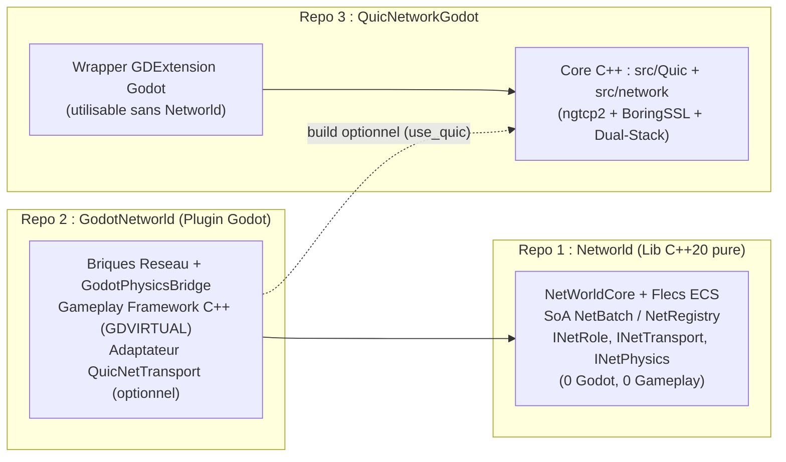
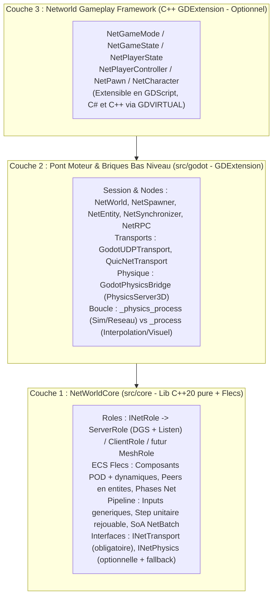
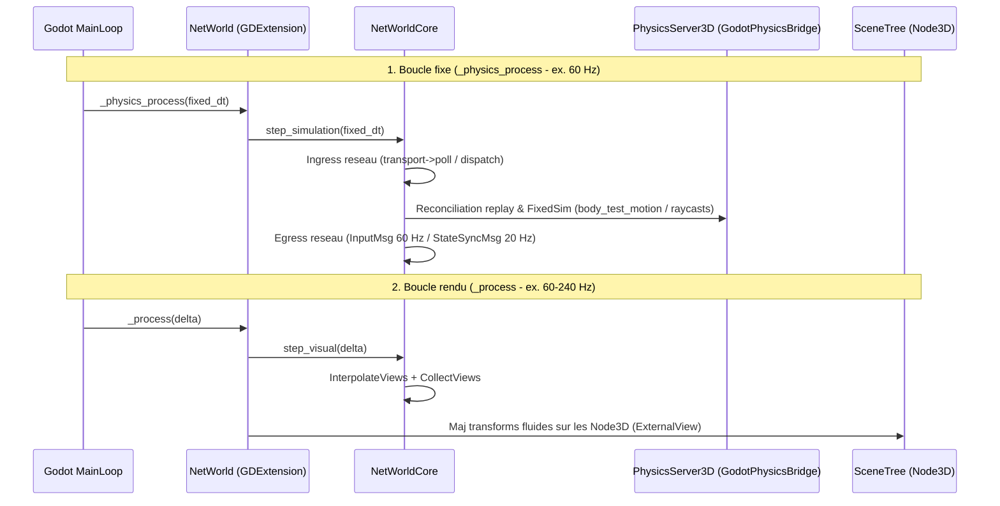

# Architecture & Plan Directeur — Networld v0.1.0

> **Date :** `2026-11-21`  
> **Statut :** 📐 Plan v1 (document vivant, appelé à évoluer au fil de l'implémentation)  
> **Point de départ :** Post-session #06 ([06_2026-11-19_interpolation_rotation_et_prediction.md](./06_2026-11-19_interpolation_rotation_et_prediction.md), commit `fea16ea`)  
> **Objectif :** Poser les frontières propres entre la librairie C++ (`Networld`), son plugin Godot (`GodotNetworld`) et le transport QUIC (`QuicNetworkGodot`) avant d'empiler physique, RPC, QUIC et Gameplay Framework.

---

## 1. Vision & Écosystème Cible (Les 3 Dépôts Publics)

Le projet vise un écosystème open-source découpé en **3 dépôts indépendants** avec des responsabilités strictes :

1. **`Networld`** *(actuellement `src/core/`)*  
   Librairie C++20 pure, orientée données (Flecs ECS + SoA), **100 % indépendante de Godot** et **sans logique gameplay**. Réutilisable hors Godot ou portable sur un autre moteur.
2. **`GodotNetworld`** *(actuellement `src/godot/`)*  
   Plugin GDExtension pour Godot 4 intégrant `Networld` : briques réseau bas niveau, pont physique `PhysicsServer3D`, et **Gameplay Framework C++** (utilisable depuis GDScript, C# et C++).
3. **`QuicNetworkGodot`** *(dépôt dédié existant : `ngtcp2` + `BoringSSL` + socket dual-stack IPv4/IPv6)*  
   Plugin GDExtension QUIC utilisable seul dans Godot, et consommable comme backend de transport dans `GodotNetworld`.

### Règles de frontière dès aujourd'hui (avant le split des repos)
- **`src/core/`** ne doit **jamais** inclure de header `godot-cpp` ni de header `QuicNetworkGodot` — uniquement la STL C++20, Flecs et ses propres interfaces abstraites.
- **`src/Quic` + `src/network`** dans `QuicNetworkGodot` gagnent à rester en **C++ pur sans dépendance Godot**, afin que `GodotNetworld` puisse les lier directement via un adaptateur `QuicNetTransport : public INetTransport` (zéro copie `Variant`/`PackedByteArray` entre deux DLL GDExtension, et activable via option de build `use_quic=yes/no` pour ne pas imposer `BoringSSL` aux utilisateurs qui utilisent un autre transport).

---

## 2. Architecture en 3 Couches

Pour concilier **zéro gameplay dans le Core** et **prise en main guidée façon Unreal Engine** dans Godot, l'architecture repose sur 3 couches empilées :

### Répartition stricte des responsabilités

| Couche | Ce qu'elle FAIT | Ce qu'elle NE FAIT PAS |
| :--- | :--- | :--- |
| **Couche 1 — `NetWorldCore`** | Transport abstrait, rôles, ownership/authority, horloge fixe, buffer d'inputs générique, réconciliation/replay, interpolation, réplication SoA (`NetBatch`), routage RPC/événements. | Aucun spawn automatique de joueur, aucune vitesse/mouvement codé en dur (`MovementSim`), aucune référence à Godot ou à un genre de jeu. |
| **Couche 2 — Briques Godot** | Lier `PackedScene` ↔ entités réseau (`NetSpawner`), exposer propriétés/composants synchronisés (`NetSynchronizer`), RPC, `GodotPhysicsBridge` (`PhysicsServer3D`), synchronisation `Node3D`, `ProjectSettings`. | N'impose pas de structure `GameMode`/`Pawn` : un jeu de cartes, un RTS ou un outil peut s'arrêter à la Couche 2. |
| **Couche 3 — Gameplay Framework** | Fournir une structure clé-en-main documentée à la Unreal (`NetGameMode`, `NetGameState`, `NetPlayerState`, `NetPlayerController`, `NetPawn`/`NetCharacter`), écrite en C++ et surchargeable via `GDVIRTUAL`. | Ne contourne jamais la Couche 2 : elle est entièrement bâtie *par-dessus* les briques de base et reste 100 % optionnelle. |

---

## 3. Piliers Techniques Détaillés

### 3.1 Topologies, Rôles & Ownership (`INetRole`)
- **v0.1.0 : Serveur Dédié (DGS) et Listen-Server (Host autoritaire).**
- Une fois le gameplay retiré de [ServerRole.cpp](../src/core/ServerRole.cpp), DGS et Listen-Server partagent **le même `ServerRole`** :
  - `NetWorldCore` introduit deux concepts génériques par entité : **Authority** (qui valide l'état) et **Ownership** (`owner_peer_id`, quel pair envoie les inputs).
  - Le serveur ne spawn rien automatiquement : il notifie la couche supérieure (`peer_connected(peer_id)` / `peer_disconnected(peer_id)`), qui décide quoi spawner et à quel `peer_id` attribuer l'ownership.
  - En **Dedicated Server** : aucun pair local (`has_local_peer = false`), tourne en **Godot `--headless`**.
  - En **Listen-Server (Host)** : un `LOCAL_PEER_ID` est enregistré localement sur `ServerRole` (un seul monde Flecs, zéro duplication mémoire, zéro latence réseau pour le Host).
- **Porte ouverte au P2P Mesh (post-v0.1.0) :** comme la topologie est encapsulée derrière [INetRole.h](../src/core/INetRole.h) et que l'autorité est portée au niveau de l'entité (plutôt que supposée exclusivement serveur), un futur `MeshPeerRole` pourra être ajouté sans refondre la réplication SoA.

### 3.2 Place de Flecs & Contrainte du « Step Unitaire Rejouable »
- **Où Flecs apporte de la valeur dans `NetWorldCore` :**
  - Stockage contigu SoA des composants répliqués (`Position3D`, `Rotation3D`, `Velocity3D`, composants custom C++ via `register_component<T>`, et composants dynamiques enregistrés au runtime pour les propriétés GDScript/C#).
  - **Phases Flecs** pour structurer proprement la boucle (`NetIngress` → `NetReconcile` → `FixedSim` → `NetInterpolate` → `NetExtract` → `CollectViews`).
  - **Peers représentés comme entités Flecs** (ex. `Peer { peer_id, rtt, last_ack_seq }`) avec des **relations** `(OwnedBy, peer_entity)` pour l'ownership et le nettoyage automatique à la déconnexion.
  - Systèmes d'interpolation (`InterpolateViews`), d'extraction SoA (`NetExtract`) et de collecte des vues (`CollectViews`).
- **Ce qui reste hors systèmes `ecs_.progress()` (en C++ direct) :**
  - Couche I/O réseau, framing binaire, `StreamWriter`/`StreamReader`, `PacketDispatcher`.
  - **Simulation prédictible et réconciliation :** lors d'une réconciliation client, il faut rejouer `N` inputs en attente d'affilée dans une seule frame **uniquement sur l'entité locale prédite** (sans faire avancer tout le reste du monde `N` fois). La simulation prédictible doit donc passer par un **step unitaire rejouable** (interface/callback `(entity_id, input_payload, fixed_dt, physics_bridge)`), appelé `1×` par tick fixe normal et `N×` lors d'un replay.
- **Inputs génériques :** remplacer le `Vec3 direction` figé de `InputMsg` ([NetMessage.h](../src/core/NetMessage.h#L125-L145)) par un payload d'input générique (flux d'octets ou structure définie par l'utilisateur / le Framework), toujours accompagné de son numéro de séquence `seq` pour l'acquittement (`ack_input_seq`).

### 3.3 Interface Physique (`INetPhysics`), `PhysicsServer3D` & Séparation de la Boucle
- **Constat technique vérifié sur `godot-cpp`** ([physics_server3d.hpp](../godot-cpp/gen/include/godot_cpp/classes/physics_server3d.hpp#L267-L445)) :
  - `PhysicsServer3D` **n'expose pas** de méthode publique `step()` / `space_step()` ni de sauvegarde/restauration d'état interne Jolt (`StateRecorder`) appelable depuis GDExtension.
  - En revanche, il expose directement les **requêtes et mouvements cinématiques sans état global** : `body_test_motion()`, `body_set_state()`/`body_get_state()`, et `PhysicsDirectSpaceState3D` (`intersect_ray`, `cast_motion`, `intersect_shape`, `get_rest_info`).
- **Choix retenu pour la v0.1.0 — Physique Cinématique (Niveau 1) :**
  - `NetWorldCore` définit une interface **optionnelle** `INetPhysics` (primitives : `test_motion` / `move_and_slide`, `raycast`, `shapecast`, lecture/écriture transform & vélocité via un `uint64_t physics_handle` opaque).
  - Si aucun moteur physique n'est injecté, `NetWorldCore` utilise un fallback intégré `DefaultKinematicPhysics` (intégration mathématique pure en C++ : le Core reste autonome).
  - Côté Godot, `GodotPhysicsBridge` implémente `INetPhysics` sur `PhysicsServer3D` (utilisant les `RID` et le `Space` du `World3D` Godot).
  - **Double avantage avec Godot `--headless` :** les développeurs construisent leurs niveaux normalement dans l'éditeur Godot (`StaticBody3D`, `CollisionShape3D`), et serveur headless comme clients interrogent exactement la même géométrie de collision via `PhysicsServer3D` en C++ natif (compatible Godot-Jolt comme GodotPhysics).
- **Séparation obligatoire de la boucle dans `NetWorld`** ([Networld.cpp](../src/godot/Networld.cpp#L152)) :

> Appeler `PhysicsServer3D` / `PhysicsDirectSpaceState3D` dans `_physics_process` garantit la sûreté thread-safe avec Godot (y compris si la physique tourne sur un thread dédié), tout en gardant un rendu interpolé fluide à la fréquence de l'écran dans `_process`.

### 3.4 Transport Réseau & Intégration QUIC (`INetTransport`)
- **Stratégie fiabilité v0.1.0 :** utiliser **QUIC (`QuicNetworkGodot` : `ngtcp2` + `BoringSSL` + socket dual-stack)** comme transport de production, évitant de réinventer une couche ACK/resend complète sur UDP brut (`GodotUdpTransport` reste utile en transport minimal LAN/debug).
- **Correspondance naturelle avec QUIC :**
  - `NetChannel::RELIABLE_EVENTS` → **QUIC Streams** (spawn, despawn, RPC fiables, ordonnancement + chiffrement TLS 1.3 natif).
  - `NetChannel::UNRELIABLE_STATE` → **QUIC Datagrams (RFC 9221)** (snapshots `StateSyncMsg`, `InputMsg`, sans *head-of-line blocking*).
- **Évolutions légères à prévoir sur [INetTransport.h](../src/core/INetTransport.h) :**
  - Exposer `virtual size_t get_max_unreliable_payload(uint32_t peer_id) const` pour respecter la PMTU des QUIC Datagrams (~1150–1200 octets) lors du découpage des gros `StateSyncMsg`.
  - Garder la configuration TLS/certificats/ALPN hors de `INetTransport` (dans `QuicConfig`, piloté côté Godot via `ProjectSettings`).
  - Le futur **NAT Traversal** restera 100 % encapsulé dans `QuicNetworkGodot` sans impacter `NetWorldCore`.

### 3.5 Double Public (C++ / GDScript / C#) & Gameplay Framework C++
- **Toutes les classes de la Couche 2 et de la Couche 3 sont écrites en C++ (GDExtension)** afin d'être nativement accessibles depuis **GDScript, C# et C++**.
- **Extensibilité :** utilisation des macros **`GDVIRTUAL`** de `godot-cpp` pour les hooks gameplay (`_on_peer_connected`, `_collect_input`, `_simulate_step`, etc.), permettant au dev GDScript/C# de surcharger le comportement comme `_ready()` ou `_physics_process()`.
- **Noyau du Gameplay Framework (Couche 3, inspiré Unreal Engine) :**
  - `NetGameMode` *(Autorité uniquement)* : règles de la partie, politique de spawn sur `peer_connected`, respawn, conditions de victoire.
  - `NetGameState` *(Répliqué à tous)* : état global partagé de la partie (phase, timer, scores d'équipe).
  - `NetPlayerState` *(1 par pair, répliqué)* : métadonnées publiques d'un joueur (pseudo, équipe, score, ping).
  - `NetPlayerController` *(Autorité + Owner)* : collecte des inputs locaux, possession d'un `NetPawn`, gestion de la caméra locale.
  - `NetPawn` / `NetCharacter` *(Contrôleur cinématique C++ prêt à l'emploi)* : mouvement + gravité + collisions via `INetPhysics` / `GodotPhysicsBridge`, rejouable 100 % en C++ lors de la réconciliation et paramétrable depuis l'Inspecteur Godot.

---

## 4. Périmètre v0.1.0 vs Post-v0.1.0

| Sujet | Inclus en **v0.1.0** | Gardé ouvert pour **Post-v0.1.0** |
| :--- | :--- | :--- |
| **Topologies** | Dedicated Server (`--headless`) + Listen-Server (Host) | P2P Mesh / Autorité distribuée / Migration d'hôte |
| **Physique prédite** | Cinématique (`body_test_motion`, gravité, pentes, raycasts) | Rollback complet `RigidBody3D` dynamiques |
| **Transport** | `GodotUdpTransport` + `QuicNetTransport` (WAN, dual-stack) | NAT Traversal (STUN/ICE/hole-punching), ENet, SteamSockets |
| **Réplication** | SoA `NetBatch` (POD C++ + propriétés custom Godot) + `NetRPC` | Delta compression avancée, Interest Management spatial |
| **Lissage client** | Interpolation entités distantes + Prédiction/Réconciliation | Buffer de snapshots anti-jitter + *error smoothing* sur correction |
| **Serveur C++ pur** | `NetWorldCore` compilable sans Godot (tests unitaires) | DGS standalone C++ complet avec backend physique hors-Godot |

---

## 5. Feuille de Route Incrémentale — v0.1.0

Chaque étape doit laisser le projet **compilable, testable et fonctionnel** :

### Étape 1 — Purge du Gameplay dans `NetWorldCore`, Ownership, Simulation Générique & 2 Pipelines
- [ ] Corriger les 2 micro-bugs de la session #06 (`if (pos && rot)` dans [ClientRole.cpp](../src/core/ClientRole.cpp#L52), aligner les 4 arguments du signal `entity_spawned` dans [Networld.cpp](../src/godot/Networld.cpp#L165)).
- [ ] Retirer `"ServerPlayer"`, l'auto-spawn et [MovementSim.h](../src/core/MovementSim.h) de `src/core/` (déplacer le mouvement de démo côté couche Godot / démo).
- [ ] Implémenter **Contrat 1** : `PEER_NONE = 0` / `PEER_SERVER = 1` / clients `>= 2`, composant POD `NetOwnership`, `HostMode` (`Dedicated` vs `Listen`), événements `peer_connected` / `peer_disconnected` et helper `destroy_entities_owned_by(peer_id)`.
- [ ] Implémenter **Contrat 2** : `WelcomeMsg { assigned_peer_id, server_tick }`, `SpawnParams` + `SpawnEntityMsg { entity_id, type_id, owner_peer_id, position, rotation, predicted }` et spawn/despawn piloté par l'extérieur (`spawn_networked_entity` / `despawn_networked_entity`).
- [ ] Implémenter **Contrat 3** : `InputPayload` inline fixe (`64 octets`, 0 allocation), `InputMsg { seq, target_entity_id, payload }` vérifié par ownership, file d'inputs bornée côté serveur (anti-speedhack) et `register_entity_simulator(type_id, callback)` avec `SimContext { core, dt, input_seq, is_replay }`.
- [ ] Implémenter **Contrat 4** : supprimer `ApplyGravity`/`ApplyMovement` de démo du Core, séparer `step_simulation(fixed_dt)` (`_physics_process` → `sim_pipeline_` / phase `NetFixedSim`) et `step_visual(delta)` (`_process` → `ecs_.progress(delta)` avec `NetInterpolate` → `NetCollectViews` + `CollectDirectViews .without<InterpolationState>()`), tout en conservant Flecs Explorer (`flecs::Rest`) actif.

### Étape 2 — Interface Physique `INetPhysics` (Cinématique) & `GodotPhysicsBridge`
- [ ] Concevoir `INetPhysics` + `DefaultKinematicPhysics` dans `src/core/` et injecter `INetPhysics&` dans `SimContext`.
- [ ] Implémenter `GodotPhysicsBridge` sur `PhysicsServer3D` (`body_test_motion`, `PhysicsDirectSpaceState3D`) dans `src/godot/`.
- [ ] Valider prédiction + réconciliation avec un vrai sol, des murs (`StaticBody3D`) et de la gravité dans `demo/`.

### Étape 3 — Intégration QUIC & Briques Godot (Couche 2)
- [ ] Adapter `INetTransport` (PMTU datagrammes) et intégrer `QuicNetTransport` depuis `QuicNetworkGodot`.
- [ ] Implémenter `NetRPC` (routage Server / Owner / Multicast, fiable via QUIC Streams ou non fiable via Datagrams).
- [ ] Créer les briques Godot C++ : `NetSpawner` (`type_id ↔ PackedScene`), `NetEntity`, `NetSynchronizer` (composants C++ + propriétés custom GDScript/C#).

### Étape 4 — Gameplay Framework C++ (Couche 3), Documentation & Démo v0.1.0
- [ ] Implémenter en C++ (`GDVIRTUAL`) : `NetGameMode`, `NetGameState`, `NetPlayerState`, `NetPlayerController`, `NetPawn` / `NetCharacter`.
- [ ] Construire une scène démo v0.1.0 propre, jouable en **Listen-Server** et en **Dedicated Server (`godot --headless`)**.
- [ ] Rédiger la documentation d'architecture & guide de démarrage du Gameplay Framework.
- [ ] Préparer le découpage physique en 3 dépôts publics (`Networld`, `GodotNetworld`, `QuicNetworkGodot`).

---

## 6. Contrats Validés pour l'Étape 1

Les 4 contrats suivants sont figés et prêts pour l'implémentation de l'Étape 1 :

1. **Contrat `Peer`, `HostMode` & `Ownership` :**
   - IDs : `PEER_NONE = 0` *(ownership monde/serveur ; `PEER_BROADCAST = 0` sur `send()`)*, `PEER_SERVER = 1` *(pair local en `HostMode::Listen`)*, clients distants `>= 2`.
   - Ownership stocké en composant POD `NetOwnership { uint32_t owner_peer_id = PEER_NONE; }` (zéro fragmentation d'archétype SoA, sérialisable nativement).
   - `HostMode::Listen` émet `peer_connected(PEER_SERVER, is_local = true)` au démarrage ; `HostMode::Dedicated` n'émet rien tant qu'aucun client ne se connecte.
   - Sur `peer_disconnected(peer_id)`, le Core laisse le jeu décider et fournit `destroy_entities_owned_by(peer_id)`.
2. **Contrat de Spawn & `WelcomeMsg` :**
   - `WelcomeMsg { uint32_t assigned_peer_id; uint32_t server_tick; }` envoyé dès la connexion d'un client.
   - `SpawnParams` / `SpawnEntityMsg` portent `{ entity_id, type_id, owner_peer_id, position, rotation, predicted }` ; `SpawnEntityMsg` est identique pour tous les pairs.
   - `NetWorldCore::spawn_networked_entity(params)` / `despawn_networked_entity(id)` pilotés de l'extérieur.
3. **Contrat d'Input Générique & Step Unitaire Rejouable :**
   - `InputPayload { static constexpr size_t MAX_SIZE = 64; uint8_t size; std::array<uint8_t, 64> data; }` (inline, 0 allocation heap).
   - `InputMsg { uint64_t seq; uint64_t target_entity_id; InputPayload payload; }` avec vérification d'ownership côté serveur et file d'inputs bornée consommée à `FIXED_DT` (anti-speedhack).
   - `register_entity_simulator(uint32_t type_id, EntitySimCallback)` avec `SimContext { NetWorldCore& core; float dt; uint64_t input_seq; bool is_replay; }`.
4. **Contrat Pipelines Flecs (`step_simulation` vs `step_visual`) :**
   - `step_simulation(fixed_dt)` (dans `_physics_process`) : Ingress C++ + Replay unitaire → exécution des simulateurs + `ecs_.run_pipeline(sim_pipeline_, fixed_dt)` (`NetFixedSim`) → Egress C++.
   - `step_visual(delta)` (dans `_process`) : `ecs_.progress(delta)` sur le pipeline visuel (`NetInterpolate` → `NetCollectViews`) afin de garder **Flecs Explorer (`flecs::Rest`)** actif.
   - Collecte des vues simplifiée en 2 systèmes toujours actifs : `CollectInterpolatedViews` et `CollectDirectViews` (`.without<InterpolationState>()`), supprimant `set_simulation_systems_enabled` / `set_interpolation_systems_enabled` ainsi que `ApplyGravity`/`ApplyMovement` de démo.
