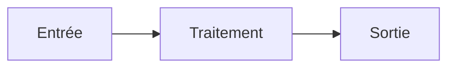

# Devlog #[NUMERO] — [Titre court de la session]

| Métadonnées | Détails |
| :--- | :--- |
| **Date** | `YYYY-MM-DD` |
| **Heure (Début → Fin)** | `HH:MM` → `HH:MM` |
| **Temps passé** | `Xh XXm` |
| **Branche / Commit** | `main` (`<hash_commit>`) |
| **Statut de fin de session** | 🟢 Compilable & Fonctionnel / 🟡 En cours (WIP) / 🔴 Bloqué (Bug) |

---

## 1. Contexte & Objectifs de la session
> *Où j'en étais en ouvrant le projet aujourd'hui, et qu'est-ce que je voulais accomplir pendant cette session ?*

- [ ] Objectif 1 : ...
- [ ] Objectif 2 : ...
- [ ] Objectif 3 : ...

---

## 2. Ce qui a été fait (Résumé des changements)
> *Liste claire des fonctionnalités ajoutées, modifiées ou supprimées.*

### Fichiers touchés
- `src/core/...` : ...
- `src/godot/...` : ...
- `demo/...` : ...

### Explication du fonctionnement
*(Expliquer ici comment les nouvelles briques s'articulent entre elles et avec l'existant)*

---

## 3. Choix Techniques & Architecture (Le "Pourquoi")
> *Pourquoi avoir codé ça de cette manière plutôt qu'une autre ? Quels compromis (performance, lisibilité, découplage) ont été faits ?*

- **Décision 1 :** ...
  - *Alternative envisagée :* ...
  - *Raison du choix :* ...

### Schéma / Flux (Optionnel)

---

## 4. Problèmes rencontrés & Solutions (Debugging)
> *Qu'est-ce qui a posé problème ou fait perdre du temps aujourd'hui, et comment ça a été résolu ?*

- **Problème :** ...
- **Cause :** ...
- **Solution :** ...

---

## 5. Où j'en suis & Prochaine Session (Reprise rapide)
> *LA section à relire en premier la prochaine fois que j'ouvre le projet !*

- **État exact du code en quittant :**
  - ...
- **Prochaines étapes immédiates (TODO de reprise) :**
  1. [ ] ...
  2. [ ] ...
  3. [ ] ...
- **Idées / Questions mises de côté pour plus tard :**
  - ...
